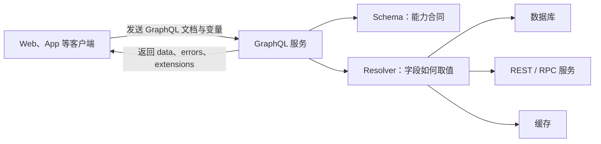
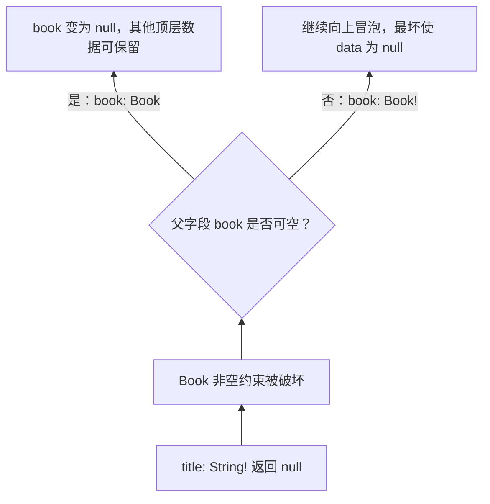
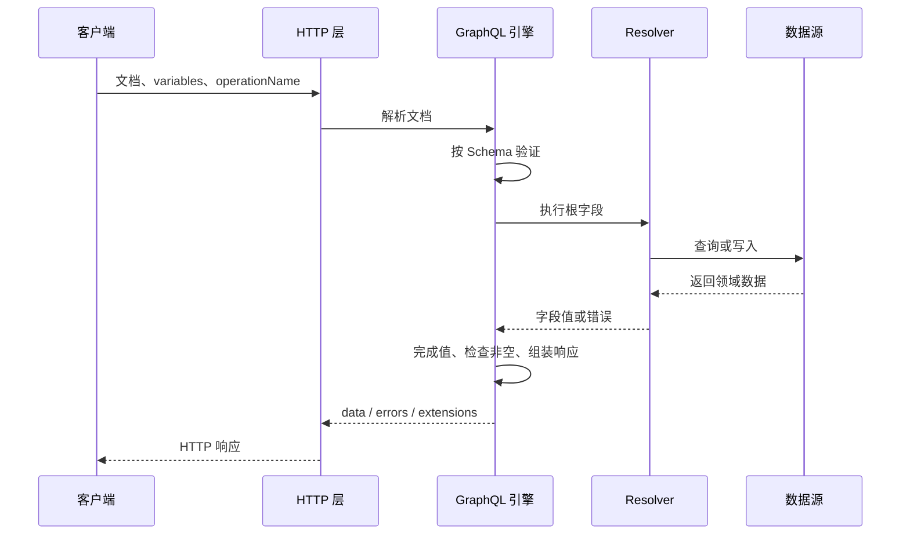
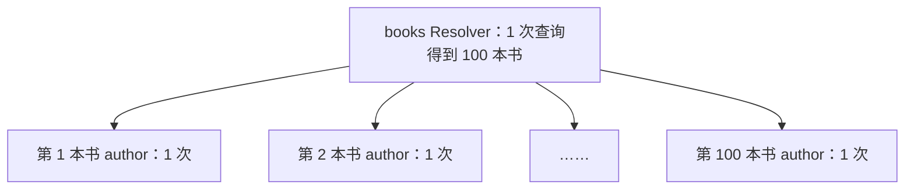
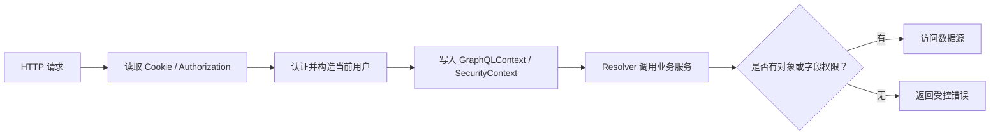
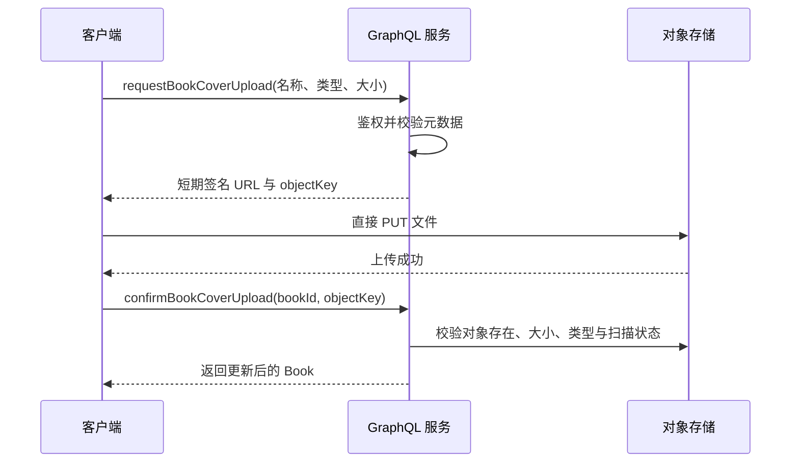
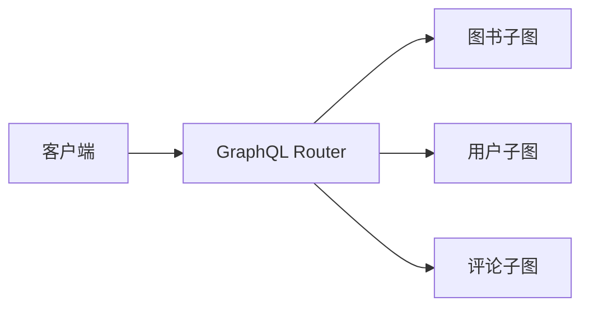

# Java 程序员的 GraphQL 从入门到生产实践

> 面向具有 Java 基础、刚接触 GraphQL 的学习者。全文使用同一个“在线图书馆”示例，以 Java、Spring Boot、Spring for GraphQL 和 GraphQL Java 为技术主线，从第一条查询逐步走到可运行服务、性能优化、安全治理和面试追问。

## 1 从图书详情页到第一条可运行查询

### 1.1 一个页面为什么会需要 GraphQL

假设图书详情页要展示书名、作者和最近三条评论，而 Web、App 和运营后台使用的字段并不相同。按资源拆分的 REST（Representational State Transfer，表述性状态转移）接口可能需要连续请求：

```text
GET /books/1
GET /authors/8
GET /books/1/reviews?limit=3
```

GraphQL 允许客户端在一次操作中声明这次需要的字段：

```graphql
query GetBookPage {
  book(id: "1") {
    title
    author {
      name
    }
    reviews(limit: 3) {
      rating
      content
    }
  }
}
```

服务端返回与选择字段基本同形的 JSON（JavaScript Object Notation，JavaScript 对象表示法）：

```json
{
  "data": {
    "book": {
      "title": "深入理解 GraphQL",
      "author": {
        "name": "林舟"
      },
      "reviews": [
        {
          "rating": 5,
          "content": "讲解很清楚"
        }
      ]
    }
  }
}
```

这个页面体现了 GraphQL 常解决的两类问题：过度获取（over-fetching）是接口返回了页面不用的字段；获取不足（under-fetching）是页面必须调用多个接口才能拼齐数据。一次 GraphQL HTTP（Hypertext Transfer Protocol，超文本传输协议）请求不等于一次数据库查询，服务端仍可能产生 N+1 等性能问题，第 7 章会给出可观察的优化方法。


N+1问题：

**N+1 问题，是指原本可以批量获取的数据，被拆成了“1 次查询 + N 次额外查询”。** 数据越多，查询次数也越多，容易拖慢服务。

例如，前端通过一次 GraphQL 请求，获取 **10 篇文章及各自的作者**：

```json
{
  posts {
    title
    author {
      name
    }
  }
}
```

如果服务端这样处理：

1. 查询文章列表：执行 **1 次**数据库查询，获得 10 篇文章。
2. 逐篇查询作者：每篇执行 **1 次**，共 **10 次**。

最终就是 **1 + 10 = 11 次数据库查询**。这里的 N 就是文章数量；如果有 100 篇文章，就可能产生 101 次查询。

所以，**前端只发了一次 HTTP 请求，并不代表服务端只查询了一次数据库**。GraphQL 决定你要哪些数据，具体如何获取数据，取决于服务端实现。

常见优化方法是**批量加载**：先查出文章，再一次性查询这些文章涉及的所有作者，把查询次数从 `1 + N` 降到 `1 + 1 = 2`。也可以使用数据库联表查询，或通过 DataLoader 这类工具合并加载请求、复用已获取的数据。


### 1.2 最小闭环：启动服务并读到一本书

下面先运行一个只支持 `book(id:)` 的服务。完成后再回看 GraphQL 的术语，读者会先知道每个概念对应哪段代码和哪项结果。

#### 1.2.1 创建项目与依赖

新建空目录 `library-graphql`，要求本机已安装 Java 17 或更高版本以及 Maven 3.6.3 或更高版本。创建 `pom.xml`：

```xml
<project xmlns="http://maven.apache.org/POM/4.0.0"
         xmlns:xsi="http://www.w3.org/2001/XMLSchema-instance"
         xsi:schemaLocation="http://maven.apache.org/POM/4.0.0 https://maven.apache.org/xsd/maven-4.0.0.xsd">
    <modelVersion>4.0.0</modelVersion>

    <parent>
        <groupId>org.springframework.boot</groupId>
        <artifactId>spring-boot-starter-parent</artifactId>
        <version>4.1.0</version>
      	<!-- 不通过本地相对路径查找父 POM，而是从 Maven 仓库解析父项目 -->
        <relativePath/>
    </parent>

    <groupId>com.example</groupId>
    <artifactId>library-graphql</artifactId>
    <version>0.0.1-SNAPSHOT</version>

    <properties>
      	<!-- 继承spring-boot-starter-parent，父 POM 会使用这个属性配置 Java 编译版本 -->
        <java.version>17</java.version>
    </properties>

    <dependencies>
        <dependency>
            <groupId>org.springframework.boot</groupId>
            <artifactId>spring-boot-starter-graphql</artifactId>
        </dependency>
        <dependency>
            <groupId>org.springframework.boot</groupId>
            <artifactId>spring-boot-starter-webmvc</artifactId>
        </dependency>
    </dependencies>

    <build>
        <plugins>
            <plugin>
                <groupId>org.springframework.boot</groupId>
                <artifactId>spring-boot-maven-plugin</artifactId>
            </plugin>
        </plugins>
    </build>
</project>
```

`spring-boot-starter-graphql` 提供 GraphQL 执行能力；GraphQL 本身不规定只能通过 HTTP 传输，所以还要加入 `spring-boot-starter-webmvc` 暴露 Web 端点。本文按 Spring Boot 4.1.x 与 Spring for GraphQL 2.0.x 编写，示例固定使用已发布的 Spring Boot 4.1.0 以便复现。

#### 1.2.2 写出最小 Schema 与 Java 入口

创建 `src/main/resources/graphql/schema.graphqls`：

```graphql
type Book {
  id: ID!
  title: String!
}

type Query {
  book(id: ID!): Book
}
```

这份 Schema 是服务端公开的类型合同：客户端可以按 ID 查询图书，并且只有得到 `Book` 后才能继续选择 `id` 与 `title`。

创建 `src/main/java/com/example/library/LibraryApplication.java`：

```java
package com.example.library;

import org.springframework.boot.SpringApplication;
import org.springframework.boot.autoconfigure.SpringBootApplication;

@SpringBootApplication
public class LibraryApplication {

    public static void main(String[] args) {
        SpringApplication.run(LibraryApplication.class, args);
    }
}
```

创建 `src/main/java/com/example/library/BookController.java`：

```java
package com.example.library;

import org.springframework.graphql.data.method.annotation.Argument;
import org.springframework.graphql.data.method.annotation.QueryMapping;
import org.springframework.stereotype.Controller;

@Controller
public class BookController {

    @QueryMapping
    public Book book(@Argument String id) {
        return "1".equals(id)
                ? new Book("1", "GraphQL 入门")
                : null;
    }

    public record Book(String id, String title) {
    }
}
```

`@QueryMapping` 把同名 Java 方法映射到 `Query.book`。参数 `id` 来自查询中的 `book(id: ...)`；返回的 `Book` record 提供与 Schema 同名的 `id()` 和 `title()` 访问器。

#### 1.2.3 启动、请求与判断结果

在项目根目录启动应用：

```bash
mvn spring-boot:run
```

看到应用监听 8080 端口后，在另一个终端发送请求：

```bash
# 注意ReadBook是客户端自定义的操作名称
# /graphql是常用约定地址，可以进行配置
curl --request POST \
  --header 'content-type: application/json' \
  --header 'accept: application/graphql-response+json' \
  --data '{"query":"query ReadBook { book(id: \"1\") { title } }"}' \
  http://localhost:8080/graphql
```

预期响应为：

```json
{
  "data": {
    "book": {
      "title": "GraphQL 入门"
    }
  }
}
```

输入是查询文档，动作是请求 `Query.book` 并继续选择 `Book.title`，输出是 `data.book.title`。成功判据包括 HTTP 响应可以解析、响应没有 `errors`，并且 `data.book.title` 等于 `GraphQL 入门`。若应用启动失败，先检查 Schema 文件路径和启动日志；若响应出现 `Cannot query field`，对照 Schema 字段名；若连接被拒绝，确认 8080 端口与 Spring Boot 进程状态。

把请求改成 `{ book(id: "1") { id } }`，响应只保留 `id`；把 ID 改成 `"404"`，`book` 返回 `null`，因为 Schema 中 `book(id: ID!): Book` 的返回类型允许为空。这两个变化分别验证了“客户端选择字段”和“返回可空性”。

### 1.3 回看刚才运行了什么

GraphQL 是一种用于 API（Application Programming Interface，应用程序编程接口）的查询语言，也是一套类型系统、验证和执行规范。刚才的闭环包含四个角色：

1\. Schema 使用 SDL（Schema Definition Language，模式定义语言）公开 `Query.book` 和 `Book.title`。

2\. 查询文档声明本次要执行的根字段、参数和子字段。

3\. Resolver（解析器）实现字段取值；Spring 的 `@QueryMapping` 方法最终注册为 GraphQL Java `DataFetcher`。

4\. GraphQL 引擎先按 Schema 验证请求，再执行字段并组装 `data`、`errors` 和可选的 `extensions`。

> 客户端按照服务端公开的类型系统声明所需字段；服务端先验证请求，再逐字段计算并返回与请求选择集相对应的数据。

GraphQL 不是数据库，也不要求图数据库。Resolver 可以读取关系数据库、NoSQL、REST 服务、RPC（Remote Procedure Call，远程过程调用）服务、缓存或内存数据，再把它们组织成面向消费者的业务图。

对于 Java 开发者，可以先建立如下对应关系：

| GraphQL 概念 | Spring for GraphQL 中的常见入口 | 类似的 Java / Spring 经验 |
| --- | --- | --- |
| Schema 字段 | `.graphqls` 文件中的字段 | 接口合同，但不是 Java 接口 |
| Query 根字段 | `@QueryMapping` 方法 | 类似只读 Controller 方法 |
| Mutation 根字段 | `@MutationMapping` 方法 | 类似执行写操作的 Controller 方法 |
| 普通对象字段 | `@SchemaMapping` 方法 | 类似按需组装 DTO（Data Transfer Object，数据传输对象）的字段 |
| Resolver | 最终注册成 GraphQL Java `DataFetcher` | 类似 MVC Handler，但粒度可细到字段 |
| 请求 Context | `GraphQLContext`、`Principal` | 类似请求作用域上下文 |

Spring for GraphQL 建立在 GraphQL Java 之上：GraphQL Java 负责解析、验证和执行；Spring for GraphQL 提供注解控制器、批量加载、异常处理、传输和测试集成；Spring Boot 提供自动配置。




Resolver/DataFethcer详解：

**Resolver 和 DataFetcher 的核心职责相同：为 GraphQL 中的某个字段提供值。** Resolver 是通用叫法，DataFetcher 则是 **GraphQL Java 中实现字段解析的接口**。[GraphQL Java 官方文档](https://graphql-java.com/documentation/data-fetching/)也明确说明了这两个名称的对应关系。

可以这样理解：

> Schema（模式）定义“可以查询什么”，Resolver / DataFetcher 定义“这个字段的值怎么得到”。

**1. Resolver：字段的解析逻辑**

假设有下面的 Schema：

```graphql
type Query {
  book(id: ID!): Book
}

type Book {
  title: String
  author: Author
}

type Author {
  name: String
}
```

客户端查询：

```json
{
  book(id: "1") {
    title
    author {
      name
    }
  }
}
```

执行时，GraphQL 会逐层解析字段：

```text
Query.book    → 根据 id 获取 Book 对象
Book.title    → 从 Book 对象读取书名
Book.author   → 根据 Book 中的 authorId 获取 Author 对象
Author.name   → 从 Author 对象读取姓名
```

**父字段返回的对象，会成为子字段解析时的输入。** 例如，`Query.book` 返回的 Book 对象，会传给 `Book.title` 和 `Book.author` 的 Resolver。[GraphQL 执行文档](https://www.graphql.org/learn/execution/)

因此，Resolver 不一定访问数据库，也可以读取对象属性、调用其他服务，或者计算一个值。

**2. DataFetcher：GraphQL Java 中的具体实现**

GraphQL Java 用 `DataFetcher<T>` 接口表达上述逻辑，核心方法是：

```java
T get(DataFetchingEnvironment environment) throws Exception;
```

例如，为 `Query.book` 和 `Book.author` 提供数据：

```java
DataFetcher<Book> bookFetcher = environment -> {
    String id = environment.getArgument("id");
    return bookService.findById(id);
};

DataFetcher<Author> authorFetcher = environment -> {
    Book book = environment.getSource();
    return authorService.findById(book.getAuthorId());
};
```

再把它们绑定到对应字段：

```java
RuntimeWiring wiring = RuntimeWiring.newRuntimeWiring()
    .type("Query", type -> type
        .dataFetcher("book", bookFetcher))
    .type("Book", type -> type
        .dataFetcher("author", authorFetcher))
    .build();
```

其中，`DataFetchingEnvironment` 封装了解析所需的信息：

| 信息                      | Java 中的常见获取方式 |
| ------------------------- | --------------------- |
| 当前字段的参数，例如 `id` | `getArgument("id")`   |
| 父字段返回的对象          | `getSource()`         |
| 请求上下文，例如当前用户  | `getGraphQlContext()` |
| 客户端选择了哪些子字段    | `getSelectionSet()`   |

这些都是 DataFetcher 取值时可使用的输入。[GraphQL Java 数据获取文档](https://graphql-java.com/documentation/data-fetching/)

**3. 为什么有些字段不用写 DataFetcher？**

因为 GraphQL Java 提供默认的 `PropertyDataFetcher`。

例如，解析 `Book.title` 时，如果 Book 对象已有 `getTitle()` 方法，默认 DataFetcher 就可以读取它；如果父对象是 `Map`，也可以读取对应的键。因此，上面的例子通常只需手写 `book` 和 `author` 的获取逻辑。[默认字段映射机制](https://graphql-java.com/documentation/data-mapping/)

最后注意两点：

- **Resolver 和 DataFetcher 通常不是前后两层。** 在 GraphQL Java 中，一个 DataFetcher 本身就承担字段 Resolver 的职责；应用可以自行在它下面划分 Service、Repository 等层。
- **`TypeResolver` 是另一个概念。** DataFetcher 决定“字段返回什么值”；TypeResolver 用于接口、联合类型，决定“这个运行时对象对应哪种具体 GraphQL 类型”。[GraphQL Java Schema 文档](https://graphql-java.com/documentation/master/schema/)

### 1.4 GraphQL、REST 与 RPC 的边界

| 维度 | GraphQL | REST | RPC |
| --- | --- | --- | --- |
| 核心抽象 | 类型化数据图与字段选择 | 资源与 HTTP 语义 | 远程方法调用 |
| 常见入口 | 单个 GraphQL 端点 | 多个资源 URL | 多个方法 |
| 返回内容 | 客户端选择字段 | 服务端预先定义 | 方法预先定义 |
| 类型合同 | Schema 是核心 | 常借助 OpenAPI | 常借助 Protobuf 等 IDL |
| 缓存 | 多为客户端规范化缓存或应用缓存 | HTTP 缓存天然直观 | 通常自行设计 |
| 适合场景 | 多端、组合型页面、数据关系丰富 | 简单资源接口、公开下载、HTTP 缓存 | 内部高性能服务调用 |

IDL 是 Interface Definition Language，即接口定义语言。选择 GraphQL 不要求替换所有 REST 或 RPC，常见架构是在多端客户端与若干后端能力之间增加 GraphQL 聚合层。

可以按需求的主要矛盾选择协议：

1\. 商品详情页要组合商品、库存、促销和评价，而且各端字段不同：优先评估 GraphQL。

2\. 下载电子书文件，希望浏览器、CDN（Content Delivery Network，内容分发网络）和断点续传直接利用标准 HTTP 语义：REST 风格的文件资源通常更自然。

3\. 两个内部 Java 服务进行高频、稳定、强约束的方法调用，而且双方共同发布：RPC 可能更直接。

4\. 页面数量少、资源关系简单、团队暂时没有 Schema 治理能力：延续现有 REST 的维护成本往往更低。

落地前应测量客户端请求次数与响应体积、服务端数据库查询数、P95/P99 延迟、缓存命中、鉴权复杂度和团队维护成本。GraphQL 的收益来自解决组合与多端差异问题，把多个 URL 机械合并成 `/graphql` 不会自动改善系统。

### 1.5 分阶段学习路线

| 阶段 | 阅读范围 | 目标 | 成功判据 |
| --- | --- | --- | --- |
| 基础闭环 | 第 1～4 章 | 理解 Schema 与查询语法，扩展出可写入的 Java 服务 | 能独立完成查询、创建和局部更新 |
| 执行与数据 | 第 5～8 章 | 理解 Resolver、错误、N+1、分页、缓存和演进 | 能从响应与 SQL 指标定位问题 |
| 生产治理 | 第 9～11 章 | 建立授权、资源预算、实时架构、可观测性和测试 | 能写出安全边界、测试与故障排查入口 |
| 复习与落地 | 第 12～14 章 | 组织面试判断、上线检查和官方资料 | 能解释取舍，并为一次 Schema 变更制定发布计划 |

第一次阅读可在完成第 4 章后先停下，确保查询、Mutation（修改操作）和局部更新都能运行，再进入执行原理与生产治理。已有 GraphQL 基础的读者可以从第 5 章开始，但第 1.2 节的成功判据仍可用于检查本地环境。

## 2 Schema：服务端公开的类型合同

### 2.1 Schema、SDL 与 Resolver 不要混淆

Schema 是服务端能力的完整类型合同。SDL（Schema Definition Language，模式定义语言）是书写这份合同的一种文本语法。Resolver 是实现合同中字段取值逻辑的函数。

可以把它们类比为：

1\. Schema：餐厅菜单所承诺的菜品。

2\. SDL：菜单采用的书写格式。

3\. Resolver：后厨具体如何制作每道菜。

SDL 写了字段但 Resolver 或默认取值拿不到符合类型的数据，请求仍会失败；只写 Resolver 而 Schema 没公开字段，客户端也无法查询。

### 2.2 一个完整但易懂的图书 Schema

```graphql
"""图书馆中可借阅的图书"""
type Book {
  id: ID!
  title: String!
  summary: String
  price: Float!
  status: BookStatus!
  author: Author!
  reviews(limit: Int = 10): [Review!]!
}

type Author {
  id: ID!
  name: String!
  books: [Book!]!
}

type Review {
  id: ID!
  rating: Int!
  content: String
  book: Book!
}

enum BookStatus {
  AVAILABLE
  BORROWED
  OFF_SHELF
}

input CreateBookInput {
  title: String!
  summary: String
  price: Float!
  authorId: ID!
}

type Query {
  book(id: ID!): Book
  books(limit: Int = 20, offset: Int = 0): [Book!]!
}

type Mutation {
  createBook(input: CreateBookInput!): Book!
}
```

把这段 Schema 与一次真实请求对应起来，会更容易理解：

```graphql
query ReadOneBook {
  book(id: "1") {
    title
    author {
      name
    }
  }
}
```

执行过程：

1\. 请求从 `Query.book` 进入，参数 `id` 必须满足 `ID!`，因此不能缺失或传 `null`。

2\. `Query.book` 返回 `Book`，客户端才能继续选择 `Book.title` 和 `Book.author`。

3\. `Book.author` 又返回 `Author`，所以客户端继续选择 `Author.name`。

4\. 客户端没有选择 `summary`、`price` 和 `reviews`，响应中就不会出现这些字段。

预期响应形状：

```json
{
  "data": {
    "book": {
      "title": "GraphQL 入门",
      "author": {
        "name": "林舟"
      }
    }
  }
}
```

这里的 Schema 只回答“允许查什么、输入输出是什么类型”，不回答数据来自哪张表。实际取值逻辑仍由 Resolver 或默认 Property DataFetcher 完成。

### 2.3 六种命名类型

GraphQL Schema 中常见的六种命名类型如下：

| 类型 | 用途 | 例子 |
| --- | --- | --- |
| Scalar | 不再拥有子字段的叶子值 | `String`、`Int`、`DateTime` |
| Object | 一组可查询字段 | `Book` |
| Enum | 有限的合法值集合 | `BookStatus` |
| Input Object | 组织复杂输入 | `CreateBookInput` |
| Interface | 多种对象共同遵守的字段合同 | `Node` |
| Union | 返回多种对象之一，不定义共同字段 | `Book | Author` |

内置 Scalar（标量）有：

1\. `Int`：32 位有符号整数，不能安全表示任意大的数据库主键。

2\. `Float`：双精度浮点数；金额通常不应直接依赖二进制浮点运算，可使用分为单位的整数或自定义 `BigDecimal`。

3\. `String`：Unicode 码点序列；具体内部编码（例如 UTF-8）由服务实现决定。

4\. `Boolean`：`true` 或 `false`。

5\. `ID`：唯一标识符，输入可接受字符串或整数字面量，输出始终序列化为字符串；它表达“用于标识而非给人阅读”的语义。

日期、长整数、Decimal 和 JSON 不是内置标量，需要选用经过维护的自定义标量实现，并明确序列化格式。

### 2.4 在 Java 中注册金额标量

自定义 Scalar 的作用，是在 GraphQL 文本值与 Java 值之间建立明确的解析、校验和序列化规则。它不是给现有 Java 类型换一个名字；服务端必须注册对应的 `GraphQLScalarType`，否则 SDL 中写了 `scalar BigDecimal` 仍无法完成运行时绑定。

为什么金额值得单独建模：

1\. GraphQL 内置 `Float` 表达双精度浮点语义，Java 金额计算通常使用 `BigDecimal` 保持十进制精度。

2\. 若不同服务各自决定保留位数、舍入模式或字符串格式，同一个 Schema 名称可能产生不同含义。

3\. 自定义标量能统一语法层面的合法值，但“价格必须大于等于零”仍是业务校验，不应全部塞进 Scalar。

一种常见做法是使用 GraphQL Java Extended Scalars。加入与项目 GraphQL Java 版本兼容的依赖：

```xml
<dependency>
    <groupId>com.graphql-java</groupId>
    <artifactId>graphql-java-extended-scalars</artifactId>
    <version>${graphql-java-extended-scalars.version}</version>
</dependency>
```

该扩展库通常不由 Spring Boot 的核心依赖管理保证版本，`${graphql-java-extended-scalars.version}` 应根据当前官方发布说明和项目中的 GraphQL Java 版本选择，不要直接复制未知项目的版本号。

把 SDL 改为：

```graphql
scalar BigDecimal

type Book {
  id: ID!
  title: String!
  price: BigDecimal!
}

input CreateBookInput {
  title: String!
  price: BigDecimal!
  authorId: ID!
}
```

再注册运行时实现：

```java
package com.example.library.config;

import graphql.scalars.ExtendedScalars;
import org.springframework.context.annotation.Bean;
import org.springframework.context.annotation.Configuration;
import org.springframework.graphql.execution.RuntimeWiringConfigurer;

@Configuration
public class GraphQlScalarConfiguration {

    @Bean
    RuntimeWiringConfigurer bigDecimalScalar() {
        return builder ->
                builder.scalar(ExtendedScalars.GraphQLBigDecimal);
    }
}
```

Spring Boot 会发现 `RuntimeWiringConfigurer` Bean，并在构建 `GraphQlSource` 时注册标量。验证时至少覆盖合法小数、负数业务校验、无法解析的字符串、极大值以及客户端实际收到的 JSON 表示。若客户端语言不能安全表示高精度数字，应进一步约定字符串或定点整数格式，而不是假设所有客户端都等同于 Java `BigDecimal`。

### 2.5 可空性是业务合同

GraphQL 类型默认可空，`!` 表示非空：

| 声明 | 列表可为 null | 元素可为 null | 空数组是否合法 |
| --- | --- | --- | --- |
| `[Book]` | 是 | 是 | 是 |
| `[Book!]` | 是 | 否 | 是 |
| `[Book]!` | 否 | 是 | 是 |
| `[Book!]!` | 否 | 否 | 是 |

`[Book!]!` 仍允许 `[]`。GraphQL 类型系统不能直接表示“至少一个元素”。

非空不是“数据库这一列现在恰好非空”，而是 API 对所有正常执行路径作出的承诺。若 `Book.title: String!` 的 Resolver 返回 `null`，GraphQL 会产生执行错误（旧版规范称字段错误），并把 `null` 向上冒泡到最近的可空父字段：



例如请求同时查询两项数据：

```graphql
query {
  book(id: "1") {
    title
  }
  books {
    id
  }
}
```

若 `book(id: "1")` 的 `title: String!` 意外返回 `null`，而根字段声明是 `book(id: ID!): Book`，响应可能是：

```json
{
  "data": {
    "book": null,
    "books": [
      {
        "id": "1"
      }
    ]
  },
  "errors": [
    {
      "message": "Cannot return null for non-nullable field Book.title.",
      "path": ["book", "title"]
    }
  ]
}
```

过程是 `t itle` 先失败，因为 `title` 非空而不能停在自身，于是错误向上到可空的 `book` 并停止；兄弟根字段 `books` 仍可保留。错误文案会因实现而不同，客户端更应关注 `path`、错误分类和业务错误码。

设计建议是：只有当服务端真的能长期保证存在时才加 `!`。把字段从可空改为非空对响应更严格，但可能使旧数据暴露执行错误；把输入参数从可选改为必填则会直接破坏旧客户端。

### 2.6 Object 与 Input Object 为什么不能混用

`type Book` 是输出类型，可以有需要计算的字段和带参数的字段。`input CreateBookInput` 是输入类型，只描述客户端可提交的数据。

不要让客户端提交整个 `Book`，因为 `id`、状态、审计字段等通常应由服务端决定。输入模型应表达一个动作真正允许用户控制的内容。

对比两个设计：

```graphql
# 不推荐：客户端可以提交本应由服务端控制的 id 和 status
type Mutation {
  createBook(book: BookInput!): Book!
}

input BookInput {
  id: ID
  title: String!
  status: BookStatus
  authorId: ID!
}

# 推荐：输入名称表达具体用例，只开放允许创建者填写的内容
type Mutation {
  createBook(input: CreateBookInput!): Book!
}
```

推荐方案中，服务端生成 `id`，并把新书状态初始化为 `AVAILABLE`。这样输入合同与业务权限一致，而不是照抄输出对象。

### 2.7 用 `@oneOf` 表达互斥输入

普通 Input Object 允许同时提交多个可选字段，无法表达“这些字段中恰好选择一个”。GraphQL 2025 年 9 月版规范纳入了 OneOf Input Object（互斥输入对象），通过内置 `@oneOf` 指令让这条规则在进入 Resolver 前完成校验。

例如，查询图书时允许使用内部 ID 或 ISBN（International Standard Book Number，国际标准书号）之一：

```graphql
input BookUniqueCondition @oneOf {
  id: ID
  isbn: String
}

type Query {
  bookBy(condition: BookUniqueCondition!): Book
}
```

下面三组输入会产生不同结果：

| 输入 | 是否合法 | 原因 |
| --- | --- | --- |
| `{"condition":{"id":"1"}}` | 是 | 只提供一个非空字段 |
| `{"condition":{"id":"1","isbn":"9787111111111"}}` | 否 | 同时提供两个字段 |
| `{"condition":{"id":null}}` | 否 | 被选择的字段必须非空 |

OneOf Input Object 中的成员字段必须声明为可空，并且不能配置默认值；“恰好一个且非空”由 `@oneOf` 统一施加。客户端仍需把外层 `condition` 作为必填参数，才能防止整个条件对象缺失。

它适合查找条件、支付方式、联系方式等互斥输入。若两个字段允许同时出现，或者多个字段需要组合成一个复合条件，就应继续使用普通 Input Object 并在业务层校验组合规则。维护旧版 GraphQL Java 项目时，要先确认运行库和客户端代码生成器是否支持 `@oneOf` 与内省字段 `__Type.isOneOf`，不能只修改 SDL 后假设所有工具都会正确识别。


内省字段：

`__Type.isOneOf` 是 GraphQL 的一个**类型内省字段**，用于查询：**某个输入对象类型是否被标记为 `@oneOf`。**

“内省（Introspection）”就是通过 GraphQL 查询服务自身的类型定义。

例如，你定义了：

```graphql
input BookUniqueCondition @oneOf {
  id: ID
  isbn: String
}
```

可以这样查询它的信息：

```graphql
query {
  __type(name: "BookUniqueCondition") {
    name
    kind
    isOneOf
  }
}
```

返回：

```json
{
  "data": {
    "__type": {
      "name": "BookUniqueCondition",
      "kind": "INPUT_OBJECT",
      "isOneOf": true
    }
  }
}
```

`isOneOf` 的含义是：

| 查询的类型                   | `isOneOf` |
| ---------------------------- | --------- |
| 带 `@oneOf` 的输入对象       | `true`    |
| 不带 `@oneOf` 的普通输入对象 | `false`   |
| 输出对象、标量等其他类型     | `null`    |

**它描述的是类型的规则，不是在检查某次传入的数据是否合法。**例如，开发工具可以读取这个字段，得知填写表单时只能选择 `id` 或 `isbn` 中的一项。


### 2.8 Interface、Union 与 `__typename`

```graphql
interface Node {
  id: ID!
}

type Book implements Node {
  id: ID!
  title: String!
}

type Author implements Node {
  id: ID!
  name: String!
}

union SearchResult = Book | Author

type Query {
  search(keyword: String!): [SearchResult!]!
}
```

查询抽象类型时，通过内联片段选择具体字段：

```graphql
# 声明名为 Search 的查询操作，由客户端自定义
# $keyword 是变量，String! 表示必须提供，且不能为 null
query Search($keyword: String!) {
  # 调用 search 字段，将变量值传给 keyword 参数
  search(keyword: $keyword) {
    # 获取当前结果的实际类型名称，例如 "Book" 或 "Author"
    __typename

    # 内联片段：当前结果为 Book 时，获取以下字段
    ... on Book {
      id     # 书籍 ID
      title  # 书名
    }

    # 内联片段：当前结果为 Author 时，获取以下字段
    ... on Author {
      id    # 作者 ID
      name  # 作者姓名
    }
  }
}
```

`__typename` 是对象上的元字段。客户端常用“类型名 + ID”作为规范化缓存键，客户端拿到数据后，可以用“对象类型 + 对象编号”唯一标识它，把同一个对象的数据统一存放。

Interface 与 Union 都能返回多种对象，但设计意图不同：

| 对比项 | Interface | Union |
| --- | --- | --- |
| 是否声明共同字段 | 是，例如 `Node.id` | 否 |
| 具体类型要求 | 必须实现共同字段合同 | 只需被列为 Union 成员 |
| 客户端可直接选择什么 | Interface 的共同字段 | 只有 `__typename`，其他字段放在 Fragment 中 |
| 适用场景 | 多种对象确实共享稳定能力 | 搜索结果、业务结果等“可能是 A 或 B” |

为什么不能只写 SDL 就结束？`search` 的声明返回 `SearchResult`，但 Resolver 实际返回的是某个 Java 对象。运行时还必须判断这个对象究竟对应 GraphQL 的 `Book` 还是 `Author`，这个职责由 TypeResolver（类型解析器）承担。

Spring for GraphQL 默认使用 `ClassNameTypeResolver`。若 Java 类的简单名称与 GraphQL Object 名称一致，第 4 章已有的 `Book` 和 `Author` 可以直接工作：

```java
@QueryMapping
public List<Object> search(@Argument String keyword) {
    // 为了突出类型解析，示例固定返回两种 Java 对象。
    return List.of(
            bookRepository.findById("1").orElseThrow(),
            authorRepository.findById("a1").orElseThrow());
}
```

提交：

```graphql
query Search($keyword: String!) {
  search(keyword: $keyword) {
    __typename
    ... on Book {
      id
      title
    }
    ... on Author {
      id
      name
    }
  }
}
```

变量为 `{"keyword": "GraphQL"}` 时，预期结果同时体现运行时类型与各自字段：

```json
{
  "data": {
    "search": [
      {
        "__typename": "Book",
        "id": "1",
        "title": "GraphQL 入门"
      },
      {
        "__typename": "Author",
        "id": "a1",
        "name": "林舟"
      }
    ]
  }
}
```

若实际返回类叫 `BookView`，而 Schema 类型叫 `Book`，默认名称匹配可能失败。此时不要随意修改 Schema 迁就内部类名，应通过 `ClassNameTypeResolver` 的类名提取或显式映射配置对应关系。验证时同时断言 `__typename` 和类型专属字段；只断言列表长度，无法证明类型解析正确。


这句话主要针对 **Union（联合类型）和 Interface（接口）返回值的实际类型判断**。

**1. 为什么需要判断类型？**

例如 Schema 定义：

```graphql
union SearchResult = Book | Author

type Book {
  id: ID!
  title: String!
}

type Author {
  id: ID!
  name: String!
}

type Query {
  search(keyword: String!): [SearchResult!]!
}
```

`search` 返回的每一项，都需要确定究竟是 `Book` 还是 `Author`。

但你的 Java 类可能叫：

```java
public record BookView(String id, String title) {}

public record AuthorView(String id, String name) {}
```

于是框架需要解决：

```text
Java 返回 BookView 对象
         ↓
它对应 Schema 中的 Book，还是 Author？
```

Spring 默认使用 `ClassNameTypeResolver` 按 Java 类的简单名称匹配 GraphQL 类型；必要时还会查找父类和接口。因此，`BookView` 默认会尝试匹配名为 `BookView` 的 GraphQL 类型，而 Schema 中只有 `Book`，就可能匹配失败。[Spring 文档](https://docs.spring.io/spring-graphql/docs/1.4.x/api/org/springframework/graphql/execution/ClassNameTypeResolver.html)


**`...` 是 GraphQL 语法中的一个固定符号，三个点要原样写，不是表示省略了代码。**

在你的查询中：

```graphql
... on Book {
  id
  title
}
```

整个结构叫**内联片段（Inline Fragment）**：

- `...`：引入片段。
- `on Book`：指定类型条件，当前对象属于 `Book` 类型时应用。
- `{ id title }`：条件满足时要读取的字段。

所以：

```graphql
search(keyword: $keyword) {
  __typename

  ... on Book {
    id
    title
  }

  ... on Author {
    id
    name
  }
}
```

表示：每条搜索结果都读取 `__typename`；如果是书，就读取 `id`、`title`；如果是作者，就读取 `id`、`name`。

`...` 还可以用来引用**具名片段**，复用字段选择：

```graphql
query {
  book(id: "1") {
    ...BookFields
  }
}

fragment BookFields on Book {
  id
  title
}
```

两种形式的区别：

| 写法                  | 含义                       |
| --------------------- | -------------------------- |
| `... on Book { ... }` | 直接在当前位置定义内联片段 |
| `...BookFields`       | 引用另行定义的具名片段     |

**2. 通过显式映射解决**

明确告诉框架：

```text
BookView.class   → GraphQL 的 Book
AuthorView.class → GraphQL 的 Author
```

配置代码：

```java
import org.springframework.context.annotation.Bean;
import org.springframework.context.annotation.Configuration;
import org.springframework.graphql.execution.ClassNameTypeResolver;
import org.springframework.graphql.execution.RuntimeWiringConfigurer;

@Configuration
public class GraphQlConfig {

    @Bean
    public RuntimeWiringConfigurer searchTypeConfigurer() {
        ClassNameTypeResolver resolver = new ClassNameTypeResolver();

        // Java 类 → Schema 中的类型名称
        resolver.addMapping(BookView.class, "Book");
        resolver.addMapping(AuthorView.class, "Author");

        // 为 SearchResult 联合类型注册这个解析器
        return builder -> builder.type(
                "SearchResult",
                typeBuilder -> typeBuilder.typeResolver(resolver)
        );
    }
}
```

配置后：

```text
BookView 对象
    ↓ 映射
GraphQL Book
    ↓
匹配 ... on Book，并返回 __typename: "Book"
```

客户端看到的类型名仍然是 `Book`。

**3. “类名提取”是另一种配置方式**

如果所有 Java 类都有统一的 `View` 后缀，可以用规则批量处理，替代逐个 `addMapping`：

```java
resolver.setClassNameExtractor(clazz -> {
    String name = clazz.getSimpleName();

    // BookView → Book；AuthorView → Author
    return name.endsWith("View")
            ? name.substring(0, name.length() - 4)
            : name;
});
```

- **显式映射**：适合类名没有统一规律，关系清晰直接。
- **类名提取**：适合整个项目遵循统一命名规则。


## 3 查询语言：客户端如何准确表达需求

### 3.1 Query 的最小结构

推荐给生产查询命名：

```graphql
query GetBookDetail {
  book(id: "1") {
    id
    title
  }
}
```

`query` 是操作类型，`GetBookDetail` 是操作名，`book` 是根字段。匿名简写 `{ book(...) { ... } }` 适合临时探索，不利于日志、指标、持久化查询和排障。

一个文档可以包含多个具名操作：

```graphql
query ReadBook {
  book(id: "1") {
    title
  }
}

query ReadBooks {
  books {
    title
  }
}
```

此时 HTTP 请求体必须用 `operationName` 指明执行哪一个，例如 `"operationName":"ReadBook"`；若文档只有一个操作，可以省略。服务端不会因为文档中出现两个 Query 就自动把二者都执行。匿名操作只能出现在文档的唯一操作中，因此生产客户端统一命名能同时减少选择歧义，并为日志、指标和受信任文档提供稳定标识。


这段话主要在说：**一个 GraphQL 文档可以放多个操作，但一次请求只选择其中一个执行。**

可以把“文档”理解为一段完整的 GraphQL 查询文本。

**1. 文档里定义了两个可选操作**

```graphql
# 第一个操作，名字是 ReadBook
query ReadBook {
  book(id: "1") {
    title
  }
}

# 第二个操作，名字是 ReadBooks
query ReadBooks {
  books {
    title
  }
}
```

这里有两个操作：

| 操作名称    | 执行内容              |
| ----------- | --------------------- |
| `ReadBook`  | 查询编号为 `"1"` 的书 |
| `ReadBooks` | 查询书籍列表          |

它们相当于两个可选入口，**服务端需要知道本次选择哪个入口。**

**2. `operationName` 用来选择操作**

发送 HTTP（Hypertext Transfer Protocol，超文本传输协议）请求时，请求体可以是：

```json
{
  "query": "query ReadBook { book(id: \"1\") { title } } query ReadBooks { books { title } }",
  "operationName": "ReadBook"
}
```

注意两个字段的区别：

- `query`：完整的 GraphQL 文档，里面可以有多个操作。
- `operationName`：本次要执行的操作名称，必须与文档中的名字匹配。

上面的请求只执行 `ReadBook`。如果改成：

```text
"operationName": "ReadBooks"
```

就只执行 `ReadBooks`。

**有多个操作却不提供 `operationName`，服务端会报错，不会默认选择第一个，也不会全部执行。**

**3. 只有一个操作时，不需要选择**

例如文档只有：

```graphql
query ReadBook {
  book(id: "1") {
    title
  }
}
```

即使没有 `operationName`，服务端也知道只能执行 `ReadBook`。

这时也允许省略操作名称，写成匿名操作：

```graphql
{
  book(id: "1") {
    title
  }
}
```

但匿名操作必须是文档里唯一的操作，不能再混入其他操作。

**4. 想一次查两种数据，可以放在同一个操作里**

```graphql
query ReadBookAndBooks {
  book(id: "1") {
    title
  }

  books {
    title
  }
}
```

这里是**一个操作、两个顶层字段**，选中这个操作后，就会查询两部分数据。

**5. 为什么建议统一命名？**

因为日志里看到：

```text
ReadBook：耗时 25ms
ReadBooks：耗时 120ms
```

比一堆“匿名查询”更容易定位问题、统计性能。

不过，操作名称是客户端填写的标签，**不能单靠名字判断请求可信，也不能保证两个同名操作的查询内容相同**；受信任文档通常还需要按文档内容或其哈希值进行识别和校验。


### 3.2 参数与变量

不要把用户输入通过字符串拼接塞进查询。应声明变量：

```graphql
query GetBookDetail($bookId: ID!) {
  book(id: $bookId) {
    id
    title
  }
}
```

变量通过独立 JSON 传入：

```json
{
  "bookId": "1"
}
```

变量的优势包括类型验证、查询文档复用、减少注入风险，并让客户端缓存与工具更容易识别操作。

“未提供变量”和“显式传 `null`”不是总等价：

1\. 未提供可触发参数默认值。

2\. 显式传 `null` 表示确实传入空值，通常不会采用默认值。

3\. 对 `ID!` 这类非空变量，两者都会在执行前失败。

### 3.3 用 ArgumentValue 实现局部更新

局部更新必须区分三种状态：

| 客户端输入 | 业务含义 |
| --- | --- |
| 不提供 `summary` | 保留原简介 |
| `"summary": null` | 主动清空简介 |
| `"summary": "新简介"` | 更新为新值 |

普通 `String`、`Optional<String>` 或简单 `@Argument` 绑定通常会把“省略”和“显式 null”都表现为空，导致服务端无法知道客户端的真实意图。Spring for GraphQL 提供 `ArgumentValue<T>` 保存这个差异。

Schema：

```graphql
input UpdateBookInput {
  title: String
  summary: String
}

type Mutation {
  updateBook(id: ID!, input: UpdateBookInput!): Book!
}
```

Java 输入对象：

```java
package com.example.library.book;

import org.springframework.graphql.data.ArgumentValue;

public record UpdateBookInput(
        ArgumentValue<String> title,
        ArgumentValue<String> summary) {
}
```

应用更新如下。这里先聚焦 `ArgumentValue` 的三个分支，片段使用的 `BookRepository`、`BookNotFoundException` 和完整 Controller 会在第 4.5～4.6 节创建：

```java
@MutationMapping
public Book updateBook(
        @Argument String id,
        @Argument UpdateBookInput input) {
    var current = bookRepository.findById(id)
            .orElseThrow(() -> new BookNotFoundException(id));

    String nextTitle = input.title().isOmitted()
            ? current.title()
            : input.title().value();
    String nextSummary = input.summary().isOmitted()
            ? current.summary()
            : input.summary().value();

    return bookRepository.update(
            current, nextTitle, nextSummary);
}
```

`isOmitted()` 为真表示客户端没有提交该字段；`value()` 为 `null` 且没有省略，表示客户端显式传了 `null`。由于 `title` 在输出合同中是 `String!`，实际项目还要拒绝把标题清空；简介可空，显式 `null` 可以作为清空操作。

验证时分别提交 `{}`、`{"summary": null}` 和 `{"summary": "新简介"}`，然后重新查询图书，确认三种数据库结果不同。这个例子也说明：GraphQL 可空性负责协议输入是否合法，具体字段能否清空仍由业务规则和数据库约束共同决定。

### 3.4 别名解决字段冲突

同一个字段使用不同参数时需要别名：

```graphql
query CompareBooks {
  beginnerBook: book(id: "1") {
    title
  }
  advancedBook: book(id: "2") {
    title
  }
}
```

响应字段名是 `beginnerBook` 和 `advancedBook`。别名也可把服务端字段名映射为页面更易读的局部名称，但滥用会增加日志与缓存分析难度。

### 3.5 Fragment 复用字段集合

```graphql
fragment BookCardFields on Book {
  id
  title
  price
  status
}

query HomePage {
  newBooks: books(limit: 5) {
    ...BookCardFields
  }
}
```

Fragment 是客户端查询文档的复用机制，不会让服务端自动只执行一次 Resolver，也不是服务端 Schema 继承。

执行前可以把 `...BookCardFields` 心智上展开为 `id`、`title`、`price`、`status` 四个字段；服务端验证和执行的是展开后等价的选择集。Fragment 解决的是查询文档重复，不是数据库查询重复。

### 3.6 指令控制字段

规范内置常用指令：

```graphql
query GetBook($id: ID!, $withSummary: Boolean! = false) {
  book(id: $id) {
    id
    title
    summary @include(if: $withSummary)
    reviews @skip(if: true) {
      rating
    }
  }
}
```

`@include(if:)` 条件为真时包含字段；`@skip(if:)` 条件为真时跳过字段。不要把授权逻辑交给客户端指令，服务端仍必须独立授权。

当变量是 `{"withSummary": false}` 时，响应中不出现 `summary`；改成 `true` 后才出现。字段“不出现”和 `"summary": null` 不同：前者表示本次选择集跳过了字段，后者表示请求了字段但结果为空。

GraphQL 还定义了用于 Schema 的指令：`@deprecated` 标记弃用字段、参数、输入字段或 Enum 值，`@specifiedBy` 给自定义 Scalar 关联格式规范，`@oneOf` 表达第 2.7 节的互斥输入。自定义指令只有在服务端注册了对应运行时行为后才会生效；在 SDL 中声明 `directive @auth ...` 本身不会完成权限检查。

### 3.7 Mutation 表达写操作

```graphql
mutation CreateBook($input: CreateBookInput!) {
  createBook(input: $input) {
    id
    title
    status
  }
}
```

变量：

```json
{
  "input": {
    "title": "GraphQL 入门",
    "summary": "从查询到生产实践",
    "price": 59.9,
    "authorId": "a1"
  }
}
```

请求示例：

```bash
# 即使执行 Mutation，请求体的字段也叫 query，不叫 mutation
curl 'http://localhost:8080/graphql' \
  -H 'Content-Type: application/json' \
  --data-raw '{
    "operationName": "CreateBook",
    "query": "mutation CreateBook($input: CreateBookInput!) { createBook(input: $input) { id title status } }",
    "variables": {
      "input": {
        "title": "GraphQL 入门",
        "summary": "从查询到生产实践",
        "price": 59.9,
        "authorId": "a1"
      }
    }
  }'
```

顶层 Mutation 字段按顺序串行执行，这是为了让有副作用的操作顺序可预测；每个顶层字段内部的子字段仍按普通字段规则执行。Query 应保持只读语义，不能因为“技术上能写数据库”就偷偷产生副作用。


注意：

**GraphQL 的 HTTP JSON 请求体主要使用这三个字段**：

| 字段            | 作用                                                         | 是否必填                   |
| --------------- | ------------------------------------------------------------ | -------------------------- |
| `query`         | GraphQL 文档，可以包含 `query`、`mutation` 或 `subscription` 操作 | 常规请求必填               |
| `variables`     | 操作中使用的变量值                                           | 没有需要提供的变量时可省略 |
| `operationName` | 指定执行文档中的哪个操作                                     | 文档有多个操作时必填       |

例如：

```json
{
  "query": "query ReadBook($id: ID!) { book(id: $id) { title } }",
  "variables": {
    "id": "1"
  },
  "operationName": "ReadBook"
}
```

**即使执行 Mutation，请求体的字段也叫 `query`，不叫 `mutation`。**

此外还有一个可选的标准字段 **`extensions`**，用于携带协议扩展信息，例如某些持久化查询方案使用的查询哈希。所以这三个是最常用的字段，并非全部字段。

```bash
{
  "operationName": "ReadBook",
  "variables": {
    "id": "1"
  },
  "extensions": {
    "persistedQuery": {
      "version": 1,
      "sha256Hash": "<完整查询文本的 SHA-256 哈希值>"
    }
  }
}
```

### 3.8 批量修改要定义清楚原子性

批量 Mutation 必须回答：

1\. 一条失败时全部回滚，还是允许部分成功？

2\. 返回整体结果，还是逐项结果？

3\. 重试是否会重复创建数据？

4\. 客户端如何提供幂等键？

对于部分成功场景，可设计逐项结果：

```graphql
type CreateBookItemResult {
  clientRequestId: ID!
  book: Book
  errorCode: String
  message: String
}
```

业务失败是预期结果时，建模为数据往往比把所有情况都塞进顶层 `errors` 更便于客户端处理。

## 4 Java 实战：把最小服务扩展为图书 API

### 4.1 目标与前置条件

本章在第 1.2 节的可运行项目上继续扩展，得到一个内存版图书 API，支持查询列表、按 ID 查询、关联作者、创建图书和局部更新图书。

前置条件：

1\. 已完成第 1.2 节，或者已有等价的 Spring Boot GraphQL 项目。

2\. Java 17 或更高版本。

3\. Maven 3.6.3 或更高版本，或直接使用项目自带的 Maven Wrapper。

4\. 熟悉 Java `record`、Spring Boot 启动类和依赖注入的基础用法。

本文框架特定示例按当前稳定的 Spring Boot 4.1.x 与 Spring for GraphQL 2.0.x 编写。若维护 Spring Boot 3.x 项目，GraphQL 核心概念和大部分业务代码仍相同，但测试 Starter、自动配置注解包名和少数扩展 API 可能不同，应切换到对应版本的官方文档，不能混用两个大版本的 import。

### 4.2 确认项目依赖

若没有复用第 1.2 节的项目，可访问 [Spring Initializr](https://start.spring.io/) 创建项目并选择：

1\. Project：Maven。

2\. Language：Java。

3\. Packaging：Jar。

4\. Dependencies：Spring for GraphQL、Spring Web、Validation。

下载后解压。复用第 1.2 节项目时，补充 Validation 与 GraphQL Test Starter 即可。Spring Boot 会管理 Spring for GraphQL 与 GraphQL Java 的兼容版本，不要为了“追新”分别覆盖它们。

核心 Maven 依赖结构应类似：

```xml
<dependencies>
    <dependency>
        <groupId>org.springframework.boot</groupId>
        <artifactId>spring-boot-starter-graphql</artifactId>
    </dependency>
    <dependency>
        <groupId>org.springframework.boot</groupId>
        <artifactId>spring-boot-starter-webmvc</artifactId>
    </dependency>
    <dependency>
        <groupId>org.springframework.boot</groupId>
        <artifactId>spring-boot-starter-validation</artifactId>
    </dependency>
    <dependency>
        <groupId>org.springframework.boot</groupId>
        <artifactId>spring-boot-starter-graphql-test</artifactId>
        <scope>test</scope>
    </dependency>
</dependencies>
```

`spring-boot-starter-graphql` 提供 GraphQL 能力，但 GraphQL 与传输协议无关，因此还需要 `spring-boot-starter-webmvc` 才能通过 Spring MVC 暴露 HTTP 端点。`spring-boot-starter-graphql-test` 会传递引入通用测试 Starter 和 `spring-graphql-test`，不必再重复声明 `spring-boot-starter-test`。

### 4.3 扩展 Schema 文件

用下面内容替换第 1.2 节的 `src/main/resources/graphql/schema.graphqls`：

```graphql
enum BookStatus {
  AVAILABLE
  BORROWED
  OFF_SHELF
}

type Author {
  id: ID!
  name: String!
}

type Book {
  id: ID!
  title: String!
  summary: String
  price: Float!
  status: BookStatus!
  author: Author!
}

input CreateBookInput {
  title: String!
  summary: String
  price: Float!
  authorId: ID!
}

input UpdateBookInput {
  title: String
  summary: String
}

type Query {
  book(id: ID!): Book
  books: [Book!]!
}

type Mutation {
  createBook(input: CreateBookInput!): Book!
  updateBook(id: ID!, input: UpdateBookInput!): Book!
}
```

Spring Boot 默认扫描 `src/main/resources/graphql/**` 下的 `.graphqls` 和 `.gqls` 文件，并在启动时构建 Schema。Schema 语法或类型引用错误会让应用启动失败，这比请求到来后才发现更安全。

第 2 章展示的是包含评论和作者反向关联的完整业务 Schema；本章为了先跑通 Java 最小闭环，暂时只保留图书与作者。学习时不要把两段 Schema 同时复制进同一个文件，否则重复定义 `Book`、`Author` 和根类型会导致启动失败。

第 1.2 节的 `com.example.library.BookController` 只服务最小体验。继续本章前应删除该文件，随后使用 `com.example.library.book.BookController` 和独立的 `Book` 类型替代它；若两个 Controller 同时存在，二者都会映射 `Query.book`，应用会因重复字段映射而启动失败。

### 4.4 创建 Java 领域对象

包名统一使用 `com.example.library`。

```java
package com.example.library.book;

import java.math.BigDecimal;

public record Book(
        String id,
        String title,
        String summary,
        BigDecimal price,
        BookStatus status,
        String authorId) {
}
```

```java
package com.example.library.book;

public enum BookStatus {
    AVAILABLE,
    BORROWED,
    OFF_SHELF
}
```

```java
package com.example.library.author;

public record Author(String id, String name) {
}
```

输入对象也可使用 `record`：

```java
package com.example.library.book;

import jakarta.validation.constraints.DecimalMin;
import jakarta.validation.constraints.NotBlank;
import jakarta.validation.constraints.NotNull;
import jakarta.validation.constraints.Size;
import java.math.BigDecimal;

public record CreateBookInput(
        @NotBlank @Size(max = 200) String title,
        @Size(max = 2000) String summary,
        @NotNull @DecimalMin("0.0") BigDecimal price,
        @NotBlank String authorId) {
}
```

`UpdateBookInput` 直接使用第 3.3 节定义的 `ArgumentValue<String>` 版本；不要改成两个普通 `String`，否则局部更新会丢失“字段省略”和“显式 null”的区别。

GraphQL `Float` 最终可以绑定为多种 Java 数字类型，但金额的业务计算应使用 `BigDecimal`。本教程为了减少第一次运行的依赖，Schema 暂时保留 `Float`；生产项目可按第 2.4 节注册 `BigDecimal` 自定义标量，避免把金额合同含糊地表示为浮点数。

### 4.5 创建内存 Repository

```java
package com.example.library.book;

import org.springframework.stereotype.Repository;

import java.math.BigDecimal;
import java.util.List;
import java.util.Optional;
import java.util.concurrent.CopyOnWriteArrayList;
import java.util.concurrent.atomic.AtomicLong;

@Repository
public class BookRepository {

    private final AtomicLong sequence = new AtomicLong(1);
    private final List<Book> books = new CopyOnWriteArrayList<>(List.of(
            new Book(
                    "1",
                    "GraphQL 入门",
                    "用一条主线掌握 GraphQL",
                    new BigDecimal("59.90"),
                    BookStatus.AVAILABLE,
                    "a1")
    ));

    public List<Book> findAll() {
        return List.copyOf(books);
    }

    public Optional<Book> findById(String id) {
        return books.stream().filter(book -> book.id().equals(id)).findFirst();
    }

    public Book save(CreateBookInput input) {
        var book = new Book(
                String.valueOf(sequence.incrementAndGet()),
                input.title(),
                input.summary(),
                input.price(),
                BookStatus.AVAILABLE,
                input.authorId());
        books.add(book);
        return book;
    }

    public Book update(
            Book current,
            String title,
            String summary) {
        var updated = new Book(
                current.id(),
                title,
                summary,
                current.price(),
                current.status(),
                current.authorId());
        int index = books.indexOf(current);
        if (index < 0) {
            throw new BookNotFoundException(current.id());
        }
        books.set(index, updated);
        return updated;
    }
}
```

```java
package com.example.library.author;

import org.springframework.stereotype.Repository;

import java.util.Collection;
import java.util.List;
import java.util.Map;
import java.util.Optional;

@Repository
public class AuthorRepository {

    private final Map<String, Author> authors =
            Map.of("a1", new Author("a1", "林舟"));

    public Optional<Author> findById(String id) {
        return Optional.ofNullable(authors.get(id));
    }

    public List<Author> findAllById(Collection<String> ids) {
        return ids.stream()
                .map(authors::get)
                .filter(java.util.Objects::nonNull)
                .toList();
    }
}
```

`CopyOnWriteArrayList` 只是让演示中的并发读写不直接破坏集合，并不等于数据库事务或生产持久化方案。

### 4.6 用注解映射 GraphQL 字段

```java
package com.example.library.book;

import com.example.library.author.Author;
import com.example.library.author.AuthorRepository;
import jakarta.validation.Valid;
import org.springframework.graphql.data.method.annotation.Argument;
import org.springframework.graphql.data.method.annotation.MutationMapping;
import org.springframework.graphql.data.method.annotation.QueryMapping;
import org.springframework.graphql.data.method.annotation.SchemaMapping;
import org.springframework.stereotype.Controller;

import java.util.List;

@Controller
public class BookController {

    private final BookRepository bookRepository;
    private final AuthorRepository authorRepository;

    public BookController(
            BookRepository bookRepository,
            AuthorRepository authorRepository) {
        this.bookRepository = bookRepository;
        this.authorRepository = authorRepository;
    }

    @QueryMapping
    public Book book(@Argument String id) {
        return bookRepository.findById(id).orElse(null);
    }

    @QueryMapping
    public List<Book> books() {
        return bookRepository.findAll();
    }

    @MutationMapping
    public Book createBook(@Argument @Valid CreateBookInput input) {
        authorRepository.findById(input.authorId())
                .orElseThrow(() -> new AuthorNotFoundException(input.authorId()));
        return bookRepository.save(input);
    }

    @MutationMapping
    public Book updateBook(
            @Argument String id,
            @Argument UpdateBookInput input) {
        var current = bookRepository.findById(id)
                .orElseThrow(() -> new BookNotFoundException(id));

        String nextTitle = input.title().isOmitted()
                ? current.title()
                : input.title().value();
        if (nextTitle == null || nextTitle.isBlank()) {
            throw new IllegalArgumentException("标题不能为空");
        }
        String nextSummary = input.summary().isOmitted()
                ? current.summary()
                : input.summary().value();

        return bookRepository.update(
                current, nextTitle, nextSummary);
    }

    @SchemaMapping(typeName = "Book", field = "author")
    public Author author(Book book) {
        return authorRepository.findById(book.authorId())
                .orElseThrow(() -> new AuthorNotFoundException(book.authorId()));
    }
}
```

```java
package com.example.library.book;

public class AuthorNotFoundException extends RuntimeException {

    public AuthorNotFoundException(String authorId) {
        super("Author not found: " + authorId);
    }
}
```

后文还会使用同样结构的 `BookNotFoundException`：

```java
package com.example.library.book;

public class BookNotFoundException extends RuntimeException {

    public BookNotFoundException(String bookId) {
        super("Book not found: " + bookId);
    }
}
```

注解与 Schema 的对应关系：

1\. `@QueryMapping` 默认把方法名映射到 `Query` 的同名字段。

2\. `@MutationMapping` 默认把方法名映射到 `Mutation` 的同名字段。

3\. `@Argument` 从 GraphQL 字段参数绑定 Java 参数。

4\. `@SchemaMapping(typeName = "Book", field = "author")` 实现 `Book.author`。

5\. `@Valid` 触发 Jakarta Bean Validation，但它不能替代作者是否存在等业务规则。

这些方法最终会被注册为 GraphQL Java 的 `DataFetcher`。它们不是 REST Controller，因此不要添加 `@GetMapping` 或 `@PostMapping`。

### 4.7 配置开发工具

在 `src/main/resources/application.yml` 中添加：

```yaml
spring:
  graphql:
    graphiql:
      enabled: true
```

GraphiQL 默认页面位于 `http://localhost:8080/graphiql`，GraphQL HTTP 端点默认是 `POST /graphql`。GraphiQL 只建议在开发环境启用，生产是否开放要结合安全策略。


这个配置用于**开启 GraphiQL，一个在浏览器中调试 GraphQL 的页面**。

服务启动后，假设端口为 `8080`，且没有额外配置路径前缀，就可以访问：

http://localhost:8080/graphiql

默认页面路径是 `/graphiql`，通常默认关闭，这项配置将它开启。[Spring Boot 文档](https://docs.spring.io/spring-boot/docs/3.2.x/reference/html/web.html#web.graphql.graphiql)

在页面里，你可以：

- 编写并执行 Query、Mutation。
- 填写 `variables` 变量。
- 查看返回数据和错误。
- 浏览 Schema 中的类型和字段，获得查询补全。

例如，在查询编辑区输入：

```graphql
query ReadBook($id: ID!) {
  book(id: $id) {
    id
    title
  }
}
```

在变量区输入：

```json
{
  "id": "1"
}
```

点击执行，页面就会向 GraphQL 接口发送请求并展示结果，类似你前面用 curl 调用接口。

两个路径要区分：

| 默认路径    | 用途                            |
| ----------- | ------------------------------- |
| `/graphql`  | 程序实际发送 GraphQL 请求的接口 |
| `/graphiql` | 供人在浏览器里操作的调试页面    |

**关闭 GraphiQL 页面，不影响 `/graphql` 接口正常提供服务。**

### 4.8 启动与验证

```bash
./mvnw spring-boot:run
```

Windows 可使用：

```powershell
mvnw.cmd spring-boot:run
```

另开终端发送请求：

```bash
curl --request POST \
  --header 'content-type: application/json' \
  --data '{"query":"query Books { books { id title author { name } } }"}' \
  http://localhost:8080/graphql
```

预期响应：

```json
{
  "data": {
    "books": [
      {
        "id": "1",
        "title": "GraphQL 入门",
        "author": {
          "name": "林舟"
        }
      }
    ]
  }
}
```

成功判据不是“Spring Boot 没报错”，而是响应中没有 `errors`，且 `data.books[0].author.name` 符合预期。

### 4.9 验证 Mutation 与输入校验

先创建一本书：

```bash
curl --request POST \
  --header 'content-type: application/json' \
  --data '{
    "operationName": "CreateBook",
    "query": "mutation CreateBook($input: CreateBookInput!) { createBook(input: $input) { id title status author { name } } }",
    "variables": {
      "input": {
        "title": "Java GraphQL 实战",
        "summary": "Spring for GraphQL 示例",
        "price": 68.0,
        "authorId": "a1"
      }
    }
  }' \
  http://localhost:8080/graphql
```

预期结果包含服务端生成的 `id` 和默认状态：

```json
{
  "data": {
    "createBook": {
      "id": "2",
      "title": "Java GraphQL 实战",
      "status": "AVAILABLE",
      "author": {
        "name": "林舟"
      }
    }
  }
}
```

这次请求的输入—过程—输出是：

1\. GraphQL 先确认 `input` 存在，并能绑定到 `CreateBookInput`。

2\. Jakarta Validation 检查标题、价格和作者 ID 的格式约束。

3\. Controller 检查作者是否真实存在，再调用 Repository 保存。

4\. 返回的 `Book` 继续解析 `author` 子字段，所以创建成功不等于字段解析一定成功。

再把标题改成空字符串。GraphQL 的 `String!` 只会拒绝 `null`，不会拒绝 `""`；真正拒绝空字符串的是 Java 输入对象上的 `@NotBlank`。预期响应包含 `errors`，并且创建逻辑不应执行。

验证写操作时至少检查三件事：响应没有非预期错误、返回字段符合业务约定、再次查询能读到新数据。仅看到 HTTP 200 或拿到一个 `id` 都不足以证明完整业务成功。

再验证局部更新。下面显式把简介清空：

```bash
curl --request POST \
  --header 'content-type: application/json' \
  --data '{
    "operationName": "UpdateBook",
    "query": "mutation UpdateBook($id: ID!, $input: UpdateBookInput!) { updateBook(id: $id, input: $input) { id title summary } }",
    "variables": {
      "id": "1",
      "input": {
        "summary": null
      }
    }
  }' \
  http://localhost:8080/graphql
```

预期 `title` 保持原值，`summary` 变为 `null`。随后把 `input` 分别改成 `{}` 和 `{"summary": "新的简介"}`：前者应同时保留标题与简介，后者只修改简介。每次都重新查询 `book(id: "1")`，才能确认 `ArgumentValue` 的三态语义真正落到了数据上。

### 4.10 本示例能证明什么

该示例能验证 SDL、Java 类型绑定、注解映射、参数、关联字段、Validation、Mutation，以及用 `ArgumentValue` 区分“省略字段”和“显式 null”的最小闭环。它不能证明生产可用性，因为：

1\. 内存数据重启后丢失。

2\. `AtomicLong` 只解决单进程演示中的编号竞争，不适合分布式 ID。

3\. 没有 Spring Security、租户授权、限流和审计。

4\. 没有真实数据库事务、连接池、超时和可观测性。

5\. `Book.author` 逐条查询会产生 N+1，第 7 章将用 `@BatchMapping` 改造。

## 5 Resolver 与执行机制

### 5.1 从 Resolver 四参数理解 Spring 方法参数

GraphQL Java 底层的 `DataFetcher` 可从 `DataFetchingEnvironment` 获取 source、arguments、GraphQLContext、字段选择集等执行信息。Spring for GraphQL 把这些内容转换为更符合 Spring 编程习惯的方法参数：

```java
@SchemaMapping(typeName = "Book", field = "author")
public Author author(
        Book book,
        GraphQLContext graphQLContext,
        DataFetchingEnvironment environment) {
    // book 是父对象；通常只声明真正需要的参数。
    return authorService.findRequired(book.authorId());
}
```

`environment` 也能提供前两个参数对应的信息：

```java
Book book = environment.getSource();
GraphQLContext context = environment.getGraphQlContext();
```

相关概念：

| GraphQL 执行概念 | Spring 方法参数 | 常见用途 |
| --- | --- | --- |
| Parent / Source | 未加注解的 `Book book` | `Book.author` 读取 `book.authorId()` |
| Arguments | `@Argument String id` | 绑定 `book(id:)` |
| Context | `GraphQLContext`、`@ContextValue` | 当前用户、请求属性、追踪信息 |
| Execution Info | `DataFetchingEnvironment` | 选择集、字段路径等高级信息 |
| Security Principal | `Principal`、`@AuthenticationPrincipal` | 获取 Spring Security 身份 |
| DataLoader | `DataLoader<K,V>` | 请求内批量加载关联数据 |

这张表描述的是：**GraphQL 解析一个字段时，能拿到哪些信息，以及 Spring 如何把这些信息传进 Java 方法。**

先看一个查询，后面都围绕它解释：

```graphql
query {
  book(id: "B1") {
    title
    author {
      name
    }
  }
}
```

解析时，先查出 `book`，再解析这本书的 `title`、`author`，最后解析作者的 `name`。

**1. Parent / Source：当前字段属于哪个对象？**

Parent 是“父对象”，Source 是“源对象”，在这里指同一个东西：**上一级字段返回的、承载当前字段的对象**。

```java
@SchemaMapping(typeName = "Book", field = "author")
public Author author(Book book) {
    return authorService.findRequired(book.authorId());
}
```

解析 `Book.author` 时，`book` 就是上一步 `Query.book` 查出来的那本书。

父对象随解析层级变化：

| 正在解析的字段 | Parent / Source |
| -------------- | --------------- |
| `Book.title`   | 当前的 `Book`   |
| `Book.author`  | 当前的 `Book`   |
| `Author.name`  | 当前的 `Author` |

因此，未加注解的 `Book book` 在这里表示框架传入的父对象。[Spring Source 说明](https://docs.spring.io/spring-graphql/reference/controllers.html#controllers-source)

**2. Arguments：客户端给当前字段传了什么参数？**

Arguments 是“字段参数”，来自查询中字段后面的括号：

```text
book(id: "B1")
```

对应：

```java
@QueryMapping
public Book book(@Argument("id") String id) {
    return bookService.findRequired(id); // id 是 "B1"
}
```

**参数属于具体字段，不会自动传给所有下级字段。**

例如：

```graphql
book(id: "B1") {
  author {
    name
  }
}
```

`id` 是 `book` 的参数。`author` 方法不能通过 `@Argument("id")` 直接读取这个上级参数；它通常通过父对象 `book` 获取所需信息。[Spring 参数绑定说明](https://docs.spring.io/spring-graphql/reference/controllers.html#controllers-argument)

**3. Context：这次执行共享哪些背景信息？**

Context 是“上下文”，适合保存一次 GraphQL 执行过程中多个字段都需要的信息，例如租户标识、追踪标识。

两种常见读取方式：

```java
// 取得整个上下文
public Author author(Book book, GraphQLContext context) {
    String tenantId = context.get("tenantId");
    return authorService.findInTenant(tenantId, book.authorId());
}
// 只取得其中一个值
public Author author(
        Book book,
        @ContextValue("tenantId") String tenantId) {

    return authorService.findInTenant(tenantId, book.authorId());
}
```

这两个例子是假设应用已经提前写入了 `tenantId`。客户端发送的请求头等信息，需要通过拦截器等机制放入上下文。

它的范围和父对象不同：**父对象随字段层级变化，主上下文在同一次执行中共享。**[Spring 上下文说明](https://docs.spring.io/spring-graphql/reference/controllers.html#controllers)

**4. Execution Info：当前字段执行到了哪里？**

Execution Info 是“执行信息”，例如字段路径、字段类型、客户端选择了哪些子字段。

`DataFetchingEnvironment` 可以提供这些信息：

```java
@SchemaMapping(typeName = "Book", field = "author")
public Author author(Book book, DataFetchingEnvironment env) {
    var path = env.getExecutionStepInfo().getPath();
    var selectionSet = env.getSelectionSet();

    return authorService.findRequired(book.authorId());
}
```

在示例查询中：

- 解析 `Book.author` 时，路径是 `/book/author`。
- 它的选择集包含 `name`，因为客户端请求了 `author { name }`。

这里需要修正表格中的一个理解：**`DataFetchingEnvironment` 的范围比 Execution Info 更广。**它还可以取得：

```text
env.getSource();         // 父对象
env.getArguments();      // 当前字段参数
env.getGraphQlContext();// 主上下文
```

所以，它是当前字段解析环境的完整入口；`Book book`、`@Argument` 等参数提供了更直接的访问方式。[GraphQL Java 执行环境说明](https://www.graphql-java.com/documentation/data-fetching/)

**5. Security Principal：当前是谁在访问？**

Principal 可以理解为“安全身份主体”，由 Spring Security 的安全上下文提供。

```java
@QueryMapping
public List<Book> myBooks(Principal principal) {
    return bookService.findByUsername(principal.getName());
}
```

`Principal` 适合读取身份名称等通用信息。

如果系统使用自定义用户对象，可以通过 `@AuthenticationPrincipal` 获取：

```java
@QueryMapping
public List<Book> myBooks(
        @AuthenticationPrincipal AppUser user) {

    return bookService.findByUserId(user.id());
}
```

这里的 `AppUser` 是示例类型，需要与你的认证配置中 `Authentication.getPrincipal()` 返回的对象匹配。

它与 `@ContextValue` 的区别是：**前者读取安全身份，后者读取 GraphQL 上下文中指定的属性。**身份是否可用，取决于当前请求的认证状态。[Spring 支持的身份参数](https://docs.spring.io/spring-graphql/reference/controllers.html#controllers-schema-mapping)

**6. DataLoader：如何合并多次关联查询？**

`DataLoader<K, V>` 是“数据加载器”：

- `K`（Key）：查询键，例如作者编号。
- `V`（Value）：返回值，例如 `Author`。

假设一次查出 100 本书，并要求每本书的作者：

```graphql
query {
  books {
    title
    author {
      name
    }
  }
}
```

逐本查询作者，可能产生：

```
1 次查询书籍 + 100 次查询作者
```

这就是 **N+1 查询问题**。

使用 DataLoader：

```java
@SchemaMapping(typeName = "Book", field = "author")
public CompletableFuture<Author> author(
        Book book,
        DataLoader<Long, Author> loader) {

    return loader.load(book.authorId());
}
```

这里假设作者编号是 `Long`。`load()` 返回一个表示未来结果的 `CompletableFuture`，让框架可以先收集多个作者编号，再交给批量加载函数处理。

**你需要预先注册批量加载函数，并在其中实现批量查询。**DataLoader 负责调度和缓存，不会自动把逐条数据库查询改写成批量查询。

通常它的缓存限定在一次请求内，同一作者编号可复用加载结果；如果执行阶段和批量大小允许，100 次作者查询便可合并为一次。[GraphQL Java 批量加载说明](https://www.graphql-java.com/documentation/batching/)

实际编写方法时，按需求选择参数：取关联数据用父对象，取客户端输入用 `@Argument`，取共享属性用上下文，取身份用安全参数；需要执行细节或批量加载时，再加入对应参数。


不要把某个用户身份写入单例 Controller 字段，否则并发请求会串号。Spring Bean 可以是单例，数据库连接池也可复用；当前用户、事务和请求级上下文必须保留正确作用域。

请求上下文解决的是“同一次 GraphQL 操作中的多个字段，如何安全共享身份、请求 ID、Locale 等横切信息”。它的生命周期是一次请求，不是应用全局，也不是父子字段之间传业务数据的万能 Map。

例如把 HTTP 请求头复制到 `GraphQLContext`：

```java
package com.example.library.config;

import org.springframework.context.annotation.Bean;
import org.springframework.context.annotation.Configuration;
import org.springframework.graphql.server.support.HttpRequestHeaderInterceptor;

@Configuration
public class GraphQlContextConfiguration {

    @Bean
    HttpRequestHeaderInterceptor requestHeaderInterceptor() {
        return HttpRequestHeaderInterceptor.builder()
                .mapHeader("X-Request-Id")
                .build();
    }
}
```

用下面的方法替换第 4.6 节 Controller 中原来的同名 `book(...)` 方法，让它按需读取请求 ID：

```java
import org.slf4j.Logger;
import org.slf4j.LoggerFactory;
import org.springframework.graphql.data.method.annotation.ContextValue;

private static final Logger log =
        LoggerFactory.getLogger(BookController.class);

@QueryMapping
public Book book(
        @Argument String id,
        @ContextValue(name = "X-Request-Id", required = false)
        String requestId) {
    log.info("query book, requestId={}, bookId={}",
            requestId, id);
    return bookRepository.findById(id).orElse(null);
}
```

执行路径是“HTTP Header → `HttpRequestHeaderInterceptor` → `GraphQLContext` → `@ContextValue` 参数”。这样 Resolver 不依赖 Servlet API，也能在 HTTP 与 WebSocket 等不同传输之间保持较清晰的边界。

验证时分别带上和省略 `X-Request-Id`，确认日志中的请求 ID 与调用一致且不会跨并发请求串号。认证信息优先通过 Spring Security 的 `Principal` 或 `@AuthenticationPrincipal` 获取；不要信任客户端随意提交的用户 ID Header 充当已认证身份。

### 5.2 默认 Resolver

如果 Java Bean 属性或 `record` 访问器与 Schema 字段同名，GraphQL Java 的默认 Property DataFetcher 通常可直接取值：

```java
public record Book(String id, String title, String authorId) {
}
```

`Book.id` 和 `Book.title` 不需要显式 `@SchemaMapping`。`Book.author` 的 Java 对象只有 `authorId`，输出却要求 `Author`，因此需要显式关联逻辑。

### 5.3 从解析到响应的完整路径



主要阶段：

1\. Parse：把查询字符串解析为 AST（Abstract Syntax Tree，抽象语法树）。语法错误在这里失败。

2\. Validate：对照 Schema 检查字段、参数、变量类型和 Fragment。验证失败时不执行 Resolver。

3\. Execute：从根类型开始调用 Resolver，递归完成字段。

4\. Complete：序列化标量、展开列表、检查非空并组装响应。

用一个错误查询观察阶段边界：

```graphql
query WrongField {
  book(id: "1") {
    title
    publisherName
  }
}
```

如果 `Book` 没有 `publisherName`，请求会在 Validate 阶段失败。`BookController.book(...)` 和 Repository 都不应被调用。典型响应只有 `errors`，没有通过执行得到的 `data`：

```json
{
  "errors": [
    {
      "message": "Validation error: Field 'publisherName' in type 'Book' is undefined"
    }
  ]
}
```

这解释了为什么“数据库中确实有 publisher_name 列”也不能让查询成功：客户端实际入口是 GraphQL Schema，不是数据库 Schema。应先在 GraphQL 类型中公开字段，再为其提供默认取值或 `@SchemaMapping`。

### 5.4 并行与串行

同一层级普通 Query 字段通常可以并行完成；顶层 Mutation 字段按文档顺序串行执行。不要依赖子字段的执行顺序实现业务事务。

```graphql
query TwoIndependentReads {
  first: book(id: "1") {
    title
  }
  second: book(id: "2") {
    title
  }
}
```

`first` 与 `second` 没有数据依赖，执行策略可以并发推进它们。这里的“可以并发”不等于保证各占一个线程，具体调度取决于 GraphQL Java 的执行策略、返回值是同步还是异步，以及 Spring 的 Executor 配置。

```graphql
mutation TwoWrites($first: CreateBookInput!, $second: CreateBookInput!) {
  firstResult: createBook(input: $first) {
    id
  }
  secondResult: createBook(input: $second) {
    id
  }
}
```

顶层 `firstResult` 完成后才开始 `secondResult`，但这仍不是数据库事务。若第二次创建失败，第一次不会因为 GraphQL 的串行语义自动回滚；要实现共同回滚，应把业务动作设计为一个 Mutation，并在应用服务中建立明确事务边界。

### 5.5 Resolver 不是业务逻辑垃圾桶

推荐分层：

```text
Resolver：协议适配、读取参数、调用应用服务、映射错误
Application Service：用例编排、权限规则、事务边界
Repository / Data Source：数据库或远程服务访问
Domain：核心业务规则
```

Controller 过胖会导致业务逻辑难以复用和单测。Controller 过薄但把授权只写在某个入口，也可能让其他入口绕过授权。事务通常放在应用服务的 `@Transactional` 方法，而不是跨多个字段 Resolver 隐式拼接；授权应放在不会被不同入口绕过的合适业务层。

## 6 HTTP、响应与错误处理

### 6.1 GraphQL 与 HTTP 的关系

GraphQL 核心规范主要描述类型、验证和执行；GraphQL over HTTP 工作草案描述如何通过 HTTP 传输。常见 POST 请求体为：

```json
{
  "query": "query GetBook($id: ID!) { book(id: $id) { id title } }",
  "operationName": "GetBook",
  "variables": {
    "id": "1"
  }
}
```

生产客户端发送 JSON 请求时使用 `Content-Type: application/json`。GraphQL over HTTP 工作草案要求客户端在 `Accept` 中包含 `application/graphql-response+json`；不确定服务端是否支持新媒体类型时，可以发送 `application/graphql-response+json, application/json;q=0.9`（q是权重值，没写默认为1，这段话意思是我优先接受 `application/graphql-response+json`；如果你只支持普通的 `application/json`，我也能处理） 兼容旧服务。

媒体类型会影响 Spring for GraphQL 2.0.x 的状态码行为：请求新媒体类型时，文档解析或验证失败会使用 4xx；请求旧的 `application/json` 时，这些 GraphQL 请求错误仍沿用 200。请求通过验证并进入执行后，Spring 当前以 200 返回 GraphQL 响应，执行错误放在 `errors` 中。客户端因此要同时解析 HTTP 状态、响应 `Content-Type` 和 GraphQL 响应体，不能把“GraphQL 的错误都返回 200”写成通用规则。GraphQL over HTTP 仍是演进中的工作草案，其他实现或后续版本可能采用不同的部分成功状态码。

GraphQL over HTTP 工作草案允许 GET 承载 Query，以便利用 HTTP 缓存，并要求拒绝通过 GET 执行 Mutation。并非每个框架默认开放 GET；Spring for GraphQL 2.0.x 默认 HTTP 端点以 `POST /graphql` 为标准请求方式，本教程不能假设把 Query 改成 GET 就一定可用。验证传输边界时，应分别测试错误 JSON、验证失败、Resolver 执行失败和成功请求，同时检查 HTTP 状态与 GraphQL 响应体。

### 6.2 响应的三个顶层成员

```json
{
  "data": {
    "book": null
  },
  "errors": [
    {
      "message": "无权查看该图书",
      "path": ["book"],
      "extensions": {
        "code": "FORBIDDEN"
      }
    }
  ],
  "extensions": {
    "requestId": "req_example"
  }
}
```

1\. `data`：执行结果；发生执行错误时仍可能有部分数据。

2\. `errors`：错误数组，常含 `message`、`locations`、`path` 与 `extensions`。

3\. `extensions`：实现自定义元数据的扩展位置。

### 6.3 请求错误与执行错误

请求错误发生在执行前，例如语法错误、未知字段、无法确定要执行的操作或变量类型错误。Resolver 不会运行。GraphQL 2025 年 9 月版规范要求 Request Error Result（请求错误结果）包含非空 `errors` 且不出现 `data`；兼容旧实现时仍可能见到 `"data": null`，两种表示都意味着没有进入字段执行。

执行错误发生在字段执行、取值或结果强制转换期间，例如数据库超时、Resolver 抛错或非空字段得到 `null`。服务端可能返回部分 `data`，并在 `errors.path` 指出失败的响应位置。旧版 GraphQL 规范和部分库文档把这类错误称为 Field Error（字段错误）。

对比两个最小例子：

| 输入 | 失败阶段 | Resolver 是否执行 | 响应特点 |
| --- | --- | --- | --- |
| 查询不存在的 `Book.publisherName` | 验证 | 否 | 通常只有 `errors` |
| `Book.author` 查询数据库时超时 | 执行 | 已执行 | 可能同时有部分 `data` 和 `errors` |

执行错误响应示例：

```json
{
  "data": {
    "book": null,
    "serverTime": "2026-07-26T10:00:00Z"
  },
  "errors": [
    {
      "message": "作者服务暂时不可用",
      "path": ["book", "author"],
      "extensions": {
        "code": "AUTHOR_SERVICE_UNAVAILABLE"
      }
    }
  ]
}
```

如果 `Book.author` 与 `Book` 在 Schema 中都是非空，错误会沿非空链冒泡，使顶层 `book` 变成 `null`；不相关的可成功根字段 `serverTime` 仍可能保留。

客户端不能只看 HTTP 200 就认定业务成功，也不能只要存在 `errors` 就丢掉全部 `data`。正确判据应结合 HTTP 状态、`errors`、目标字段、业务结果和本地缓存更新。

### 6.4 预期业务失败与异常失败

“ISBN 已存在”“作者编号不存在”是用户可修复的预期业务结果，可以作为联合类型或 Payload 数据建模：

```graphql
type CreateBookSuccess {
  book: Book!
}

type ValidationProblem {
  field: String
  message: String!
}

union CreateBookResult = CreateBookSuccess | ValidationProblem

type Mutation {
  createBook(input: CreateBookInput!): CreateBookResult!
}
```

在 Java 中，可以让两个结果实现同一个密封接口。以下三个类型分别放入同名 `.java` 文件：

```java
package com.example.library.book;

public sealed interface CreateBookResult
        permits CreateBookSuccess, ValidationProblem {
}
```

```java
package com.example.library.book;

public record CreateBookSuccess(Book book)
        implements CreateBookResult {
}
```

```java
package com.example.library.book;

public record ValidationProblem(String field, String message)
        implements CreateBookResult {
}
```

下面是第 4 章 `createBook` 的另一种设计，不能与原来返回 `Book` 的方法同时保留：

```java
@MutationMapping
public CreateBookResult createBook(
        @Argument @Valid CreateBookInput input) {
    if (authorRepository.findById(input.authorId()).isEmpty()) {
        return new ValidationProblem(
                "authorId", "指定的作者不存在");
    }
    return new CreateBookSuccess(
            bookRepository.save(input));
}
```

Java 结果类名与 GraphQL Object 类型名一致，因此 Spring 默认 TypeResolver 可以把 `CreateBookSuccess` 和 `ValidationProblem` 分辨出来。客户端必须用 `__typename` 和 Fragment 处理两种返回值：

```graphql
mutation CreateBook($input: CreateBookInput!) {
  createBook(input: $input) {
    __typename
    ... on CreateBookSuccess {
      book {
        id
        title
      }
    }
    ... on ValidationProblem {
      field
      message
    }
  }
}
```

当 `authorId` 不存在时，预期业务失败出现在 `data` 中，而不是顶层 `errors`：

```json
{
  "data": {
    "createBook": {
      "__typename": "ValidationProblem",
      "field": "authorId",
      "message": "指定的作者不存在"
    }
  }
}
```

这种设计适合客户端能够修正、且属于正常业务分支的失败。数据库宕机、代码缺陷和依赖超时不应伪装成 `ValidationProblem`，它们更适合顶层 `errors`，同时服务端记录完整内部日志。不要把堆栈、SQL、文件路径或敏感参数暴露给客户端。测试时应分别断言成功分支、业务失败分支和异常分支，防止所有错误都被错误地包装成 HTTP 200 下的“成功数据”。

### 6.5 用 Spring 统一映射异常

Controller 抛出的异常可用 `@GraphQlExceptionHandler` 统一映射：

```java
@ControllerAdvice
public class GlobalGraphQlExceptionHandler {

    @GraphQlExceptionHandler
    public GraphQLError handleAuthorNotFound(
            AuthorNotFoundException exception,
            GraphqlErrorBuilder<?> errorBuilder) {
        return errorBuilder
                .errorType(ErrorType.NOT_FOUND)
                .message("作者不存在")
                .extensions(Map.of("code", "AUTHOR_NOT_FOUND"))
                .build();
    }

    @GraphQlExceptionHandler
    public GraphQLError handleBookNotFound(
            BookNotFoundException exception,
            GraphqlErrorBuilder<?> errorBuilder) {
        return errorBuilder
                .errorType(ErrorType.NOT_FOUND)
                .message("图书不存在")
                .extensions(Map.of("code", "BOOK_NOT_FOUND"))
                .build();
    }
}
```

需要导入：

```java
import graphql.GraphQLError;
import graphql.GraphqlErrorBuilder;
import org.springframework.graphql.data.method.annotation.GraphQlExceptionHandler;
import org.springframework.graphql.execution.ErrorType;
import org.springframework.web.bind.annotation.ControllerAdvice;

import java.util.Map;
```

使用框架准备好的 `GraphqlErrorBuilder`，可以保留当前字段的 path 和 location。对非注解 Controller 的自定义 `DataFetcher`，可实现 `DataFetcherExceptionResolver`。无论哪种方式，都应在服务端按请求 ID 记录原始异常，并只向客户端返回稳定、脱敏的信息。


这段话讲的是：**GraphQL 字段执行出错时，怎样向客户端返回有用的错误信息，同时让服务端能够排查问题。**

**1. `GraphqlErrorBuilder` 保留错误发生的位置**

GraphQL 的错误除了 `message`，还可以包含：

| 属性        | 含义                                   | 示例                         |
| ----------- | -------------------------------------- | ---------------------------- |
| `path`      | 出错字段在响应数据中的路径             | `["book", "author", "name"]` |
| `locations` | 出错字段在客户端查询文本中的行号、列号 | `[{"line": 4, "column": 5}]` |

注意：这里的 `locations` **不是 Java 代码的行号**。

假设客户端查询：

```graphql
query {
  book(id: "1") {
    title
    author {
      name
    }
  }
}
```

如果获取 `author` 时发生异常，`path` 可以帮助客户端知道：**失败的是 `book.author` 这个字段**。

在使用 `@GraphQlExceptionHandler` 时，Spring 可以提供一个已经绑定当前字段执行环境的构建器：

```java
@GraphQlExceptionHandler
public GraphQLError handle(
        BookNotFoundException ex,
        GraphqlErrorBuilder<?> builder) {

    return builder
            .errorType(ErrorType.NOT_FOUND)
            .message("图书不存在")
            .build();
}
```

这里直接使用参数中的 `builder`，生成的错误会带上当前字段的路径和查询位置。[Spring 官方文档](https://docs.spring.io/spring-graphql/reference/controllers.html)

**2. 自定义 `DataFetcher`，可以通过异常解析器处理错误**

`DataFetcher` 可以理解为：**负责为某个 GraphQL 字段获取数据的函数**。

通常你写：

```java
@QueryMapping
public Book bookById(@Argument Long id) {
    return bookService.findById(id);
}
```

Spring 会把这个方法注册成 `DataFetcher`。你也可以直接编写并注册 `DataFetcher`，不经过注解控制器。

对于这种自定义数据获取逻辑，可以实现 `DataFetcherExceptionResolver`，把 Java 异常转换成 GraphQL 错误。常用的便捷写法是：

```java
@Bean
DataFetcherExceptionResolver bookExceptionResolver() {
    return DataFetcherExceptionResolver.forSingleError((ex, env) -> {
        if (ex instanceof BookNotFoundException) {
            return GraphqlErrorBuilder.newError(env)
                    .errorType(ErrorType.NOT_FOUND)
                    .message("图书不存在")
                    .build();
        }

        return null; // 当前解析器不处理，交给后续解析器
    });
}
```

这里的关键是：

```text
GraphqlErrorBuilder.newError(env)
```

传入 `env`（`DataFetchingEnvironment`，数据获取环境），才能自动填入当前字段的路径和位置。Spring Boot 会自动发现这类解析器 Bean。[Spring 异常处理文档](https://docs.spring.io/spring-graphql/reference/request-execution.html)


## 7 数据访问、N+1 与分页

### 7.1 N+1 如何产生

查询 100 本书及其作者：

```graphql
query {
  books {
    title
    author {
      name
    }
  }
}
```

朴素实现可能先查一次图书，再为每本书各查一次作者，总计 101 次查询。



### 7.2 DataLoader 的批处理与请求级缓存

DataLoader 的核心不是“永久缓存”，而是在一个短批处理窗口内收集 key，一次批量读取，再按输入 key 的顺序返回结果。

Spring for GraphQL 最简洁的做法是 `@BatchMapping`：

```java
import org.springframework.graphql.data.method.annotation.BatchMapping;

import java.util.LinkedHashMap;
import java.util.List;
import java.util.Map;
import java.util.function.Function;
import java.util.stream.Collectors;

// 把这个方法加入第 4 章已有的 BookController，
// 并删除原来的 @SchemaMapping Book.author 方法。
@BatchMapping(typeName = "Book", field = "author")
public Map<Book, Author> authors(List<Book> books) {
    var authorIds = books.stream()
            .map(Book::authorId)
            .collect(Collectors.toSet());

    var authorsById = authorRepository.findAllById(authorIds).stream()
            .collect(Collectors.toMap(Author::id, Function.identity()));

    var result = new LinkedHashMap<Book, Author>();
    for (var book : books) {
        var author = authorsById.get(book.authorId());
        if (author != null) {
            result.put(book, author);
        }
    }
    return result;
}
```

不要用这个片段覆盖整个 `BookController`，它只是对关联字段方法的改造。若同时保留原先同一字段的 `@SchemaMapping Book.author`，应用会出现重复映射。

以 100 本书都属于作者 `a1` 为例：

1\. 输入：GraphQL 执行先得到 100 个 `Book` 父对象，并收集 100 次 `author` 字段加载请求。

2\. 批处理：`@BatchMapping` 一次收到 100 本书，先把作者 ID 去重为集合 `{"a1"}`。

3\. 数据访问：`findAllById` 只进行一次批量查询，而不是执行 100 次 `findById`。

4\. 输出：返回 `Map<Book, Author>`，Spring 再把每个 Book 与对应 Author 分发回原字段。

`Book` 被用作 Map 的 key，因此必须正确实现 `equals` 和 `hashCode`；本笔记使用 Java `record`，编译器已经生成二者。若某本书找不到作者，结果 Map 中不会有该 key，字段会得到 `null`；由于 Schema 声明 `author: Author!`，随后会产生非空错误。生产系统应通过外键、数据治理或明确异常保证该合同。

`@BatchMapping` 是 Spring 对 `BatchLoaderRegistry` 和 DataLoader 常见用法的封装。

如果需要直接使用 DataLoader，可注册批量加载函数，再把 DataLoader 注入映射方法。下面的方案与 `@BatchMapping` 二选一，不能同时映射 `Book.author`：

```java
import org.dataloader.DataLoader;
import org.springframework.graphql.data.method.annotation.SchemaMapping;
import org.springframework.graphql.execution.BatchLoaderRegistry;
import org.springframework.stereotype.Controller;
import reactor.core.publisher.Mono;

import java.util.concurrent.CompletableFuture;
import java.util.function.Function;
import java.util.stream.Collectors;

@Controller
public class BookAuthorController {

    public BookAuthorController(
            BatchLoaderRegistry registry,
            AuthorRepository authorRepository) {
        registry.forTypePair(String.class, Author.class)
                .registerMappedBatchLoader((ids, environment) ->
                        Mono.fromSupplier(() ->
                                authorRepository.findAllById(ids).stream()
                                        .collect(Collectors.toMap(
                                                Author::id,
                                                Function.identity()))));
    }

    @SchemaMapping(typeName = "Book", field = "author")
    public CompletableFuture<Author> author(
            Book book,
            DataLoader<String, Author> loader) {
        return loader.load(book.authorId());
    }
}
```

关键约束：

1\. 列表式 BatchLoader 的返回数组长度和顺序必须与输入 key 一致；Mapped BatchLoader 则按 key 返回 Map。

2\. 关联字段声明为非空时，缺失作者不能悄悄返回 null，应保证数据约束或转成受控错误。

3\. DataLoader Registry 通常按请求创建，Spring for GraphQL 会协助处理请求级注册。

4\. 批量查询也必须携带租户与权限条件，不能因为合并 SQL 就绕过行级授权。

5\. 同一请求内 Mutation 更新数据后，应 `clear` 或 `prime` 相关 key，避免读到旧值。


第5小点的补充解释：

这句话的关键是：**数据库更新成功后，DataLoader 并不知道数据变了；同一个请求里再次加载相同 key，可能仍然拿到之前缓存的结果。**

下面以 `DataLoader<String, Author>` 为例，假设使用默认的请求级缓存。

**1．为什么更新后还可能读到旧数据？**

假设数据库里最初是：

```text
a1 → Author("a1", "旧名字")
```

同一个请求中，先读取作者：

```text
loader.load("a1");
```

批量查询完成后，可以把缓存理解为：

```text
"a1" → Author("a1", "旧名字")
```

实际上，Java DataLoader 的本地缓存保存的是 `CompletableFuture<Author>`，也就是代表加载结果的异步对象，因此它还能复用尚未完成的加载。[Java DataLoader 源码](https://github.com/graphql-java/java-dataloader/blob/master/src/main/java/org/dataloader/DataLoader.java)

随后执行数据库更新：

```java
Author updatedAuthor =
    authorService.rename("a1", "新名字");
```

此时两个地方的数据可能不同：

```text
数据库：       a1 → 新名字
DataLoader：  a1 → 旧名字
```

再次执行：

```java
loader.load("a1");
```

就可能直接命中旧缓存，不再查数据库。

**2．`clear(id)`：忘掉旧结果，下次重新查询**

```java
loader.clear("a1");
```

它的意思是：

> 删除这个 key 的缓存记录。

执行之后：

```text
数据库：       a1 → 新名字
DataLoader：  不再缓存 a1
```

下一次：

```java
loader.load("a1");
```

会重新进入加载流程，等批次执行时查询数据库。**`clear` 本身不会查询数据库，也不会修改数据库。**

因此，更新后只清缓存也是合理做法：

```java
authorService.rename("a1", "新名字");
loader.clear("a1");
```

适合你没有完整的新对象，或者希望后续读取以数据库结果为准的情况。

**3．`prime(id, value)`：在没有缓存时，预先填入结果**

```java
loader.prime("a1", updatedAuthor);
```

可以理解为：

> 如果这个 key 还没有缓存，就直接使用我提供的对象作为加载结果。

它更接近 `putIfAbsent`，而不是普通 Map 的 `put`：

```java
// 仅用于解释语义，不是实际实现
cache.putIfAbsent(id, completedFuture(updatedAuthor));
```

所以，如果已经缓存了旧作者：

```text
执行前：
a1 → 旧名字

执行：
prime("a1", 新作者)

执行后：
a1 → 仍然是旧名字
```

**`prime` 的用途是预填充缓存，不是覆盖已有缓存。** 这是接口的明确约定。[`prime` 方法定义](https://github.com/graphql-java/java-dataloader/blob/master/src/main/java/org/dataloader/DataLoader.java)

**4．为什么要组合成 `clear(id).prime(id, updatedAuthor)`？**

因为两步各做一件事：

```java
loader.clear("a1")                  // 删除可能存在的旧结果
      .prime("a1", updatedAuthor);  // 填入已经拿到的新结果
```

执行过程：

```text
原缓存：       a1 → 旧作者
clear 后：     无 a1
prime 后：     a1 → 新作者
后续 load：    直接得到新作者
```

这样既避免旧数据，又省掉了一次重新查询。

| 操作                            | 后续 `load(id)` 的行为 |
| ------------------------------- | ---------------------- |
| 什么都不做                      | 可能复用旧缓存         |
| 只 `clear(id)`                  | 重新加载               |
| 只 `prime(id, newValue)`        | 已有缓存时保留原缓存   |
| `clear(id).prime(id, newValue)` | 使用预填入的新结果     |

**5．放到 Spring for GraphQL 中怎么写？**

沿用前面按 `String → Author` 注册的 DataLoader，可以在 Mutation 方法里更新缓存：

```java
@MutationMapping
public Author renameAuthor(
        @Argument String id,
        @Argument String name,
        DataLoader<String, Author> loader) {

    // 假设这是带事务的服务方法，返回成功时事务已提交
    Author updatedAuthor = authorService.rename(id, name);

    // 更新当前请求使用的这个 DataLoader
    loader.clear(id).prime(id, updatedAuthor);

    return updatedAuthor;
}
```

这里 `return updatedAuthor` 本身就返回新对象。**更新 DataLoader 是为了让当前请求后续其他字段再通过该 loader 读取同一作者时，也能得到新对象。**

如果更新失败，代码不应该继续执行到 `prime`。如果事务在更外层才提交，也要把缓存更新时机与实际事务结果协调好。

**6．还有三个容易混淆的地方**

第一，**只影响这个 DataLoader 的后续加载**。已经拿到的旧对象、已经返回的旧 `CompletableFuture`，不会因为 `clear().prime()` 自动变成新结果。`clear` 也不是取消正在执行的查询。

第二，**必须操作正确的 key 和正确的加载器**。这里的 key 是作者 ID，所以使用 `clear("a1")`。前面的 `@BatchMapping` 示例以 `Book` 为 key，不能直接套用作者 ID 来清理；如果另一个加载器按作者姓名缓存，也需要处理对应的失效。

第三，**普通请求级缓存不会带到下一个请求**。如果某次 Mutation 之前没有加载过作者，或者后续也不会再加载，那么不一定需要做这一步。它主要解决的是“同一请求内，先读、再写、又读”的一致性问题。

实际选择可以很直接：**手上只有更新成功的消息，就 `clear`；手上已有完整、可信的新对象，就 `clear().prime()`。**


关于CompletableFuture的解释：

这里返回 `CompletableFuture<Author>`，是因为 **`loader.load()` 被调用时，作者通常还没有查询出来，只是提交了一个加载请求。**

DataLoader 要先收集其他书的作者 ID，再一起查询。如果要求这个方法立刻返回 `Author`，就无法自然地等待后续请求参与批处理。

我们按执行过程来看。

**1．普通方法：调用时就去查询**

```java
public Author author(Book book) {
    return authorRepository.findById(book.authorId())
            .orElse(null);
}
```

执行过程是：

```text
解析第一本书的 author
    → 查询数据库
    → 得到 Author
    → 返回

解析第二本书的 author
    → 查询数据库
    → 得到 Author
    → 返回
```

方法返回时，必须已经拿到了 `Author`。这样容易变成每本书查一次。

**2．DataLoader：先登记需求，稍后交付结果**

```java
public CompletableFuture<Author> author(
        Book book,
        DataLoader<String, Author> loader) {
    return loader.load(book.authorId());
}
```

这里的 `load("a1")` 可以理解为：

> 我需要作者 a1。先给我一个代表这次加载结果的对象，等批量查询完成，再把作者放进去。

这个“代表将来结果的对象”，就是 `CompletableFuture<Author>`。

可以把两种类型这样区分：

```java
Author
// 作者对象，已经拿到了

CompletableFuture<Author>
// 代表一次加载的结果：可能还没完成，也可能已经完成
```

`CompletableFuture` 是 Java 的类名，意思近似“可被完成的未来结果”。它可以正常完成并提供 `Author`，也可以异常完成。

**3．三本书加载作者时，实际发生了什么？**

假设：

```text
Book b1 → a1
Book b2 → a2
Book b3 → a3
```

GraphQL 分别调用字段方法：

```text
author(b1, loader);  // load("a1")，返回 future1
author(b2, loader);  // load("a2")，返回 future2
author(b3, loader);  // load("a3")，返回 future3
```

此时可以理解为：

```text
待查询队列：[a1, a2, a3]

future1：等待 a1 的结果
future2：等待 a2 的结果
future3：等待 a3 的结果
```

到了批次执行阶段，框架触发 DataLoader 批量加载：

```java
authorRepository.findAllById(Set.of("a1", "a2", "a3"));
```

得到结果后，DataLoader 按 key 分发：

```text
a1 的 Author → 完成 future1
a2 的 Author → 完成 future2
a3 的 Author → 完成 future3
```

GraphQL 再把这些结果填入对应书的 `author` 字段。

**因此，字段方法先返回 Future，GraphQL 稍后使用 Future 中完成的结果。**

**4．谁在等这个 Future？**

是 GraphQL 执行引擎。

你只需要：

```java
return loader.load(book.authorId());
```

GraphQL 能识别 `CompletableFuture`，会在构造响应时等待它完成。客户端收到的仍是普通数据：

```json
{
  "data": {
    "books": [
      {
        "author": {
          "name": "作者甲"
        }
      }
    ]
  }
}
```

客户端看不到 `CompletableFuture`。它只是 Java 服务端协调加载过程的工具。

**5．为什么不能自己把 Author 取出来再返回？**

你可能会想到：

```java
public Author author(
        Book book,
        DataLoader<String, Author> loader) {
    return loader.load(book.authorId()).join();
}
```

这里 `join()` 的意思是：阻塞当前线程，直到 Future 完成。

但此时 DataLoader 可能还在等框架触发批次：

```text
字段方法调用 join()
    → 等待批量查询完成

批量查询
    → 尚未被框架触发
```

这会阻塞执行流程，在某些执行配置下甚至可能一直等下去。因此，**应把 Future 直接交给 GraphQL，让框架协调后续执行。**

还有一点：返回 `CompletableFuture` **不代表一定新开了一个线程**。在这里，它首先解决的是“先返回一个结果占位，等批量加载完成再交付数据”。数据库操作是否阻塞、运行在哪个线程，是另一个问题。

再看原代码就很直观了：

```java
@SchemaMapping(typeName = "Book", field = "author")
public CompletableFuture<Author> author(
        Book book,
        DataLoader<String, Author> loader) {

    // 登记这本书需要哪个作者，
    // 把代表加载结果的 Future 交给 GraphQL。
    return loader.load(book.authorId());
}
```


### 7.3 接入 Spring Data JPA 时的边界

接入 JPA（Jakarta Persistence，Java 持久化规范）后，需要明确三个职责：Repository（仓储）负责数据库访问，应用服务负责业务用例与事务边界，Resolver（字段解析器）负责把 GraphQL 字段连接到应用服务。DataLoader 则负责合并执行过程中分散产生的加载请求。

#### 7.3.1 在应用服务中完成查询与数据转换

真实项目通常在应用服务中查询 Repository，再返回不依赖懒加载的 DTO（Data Transfer Object，数据传输对象）。下面是固定图书详情用例的分层示意；需要项目已有的实体、仓储和业务异常，并非对第 4 章内存示例的直接替换。

```java
import org.springframework.stereotype.Service;
import org.springframework.transaction.annotation.Transactional;

@Service
public class BookApplicationService {

    private final BookJpaRepository bookRepository;

    public BookApplicationService(BookJpaRepository bookRepository) {
        this.bookRepository = bookRepository;
    }

    @Transactional(readOnly = true)
    public BookDetail findRequired(String id) {
        return bookRepository.findDetailById(id)
                .map(BookDetail::from)
                .orElseThrow(() -> new BookNotFoundException(id));
    }
}
```

这段代码依次完成：查询书籍、转换 DTO、找不到时抛出业务异常。`findRequired` 表达“这本书必须存在”；GraphQL 层再按第 6 章的方式把异常转换为客户端可理解的错误。

假设详情固定需要作者姓名，DTO 可以定义为：

```java
public record BookDetail(
        String id,
        String title,
        String authorName) {

    public static BookDetail from(BookEntity book) {
        return new BookDetail(
                book.getId(),
                book.getTitle(),
                book.getAuthor().getName());
    }
}
```

这里假设作者必须存在。`BookDetail::from` 在事务方法内部执行，需要的关联数据应在此阶段读取完毕。返回后，GraphQL 读取的是普通字符串，不需要再通过实体代理查询数据库。

所谓“稳定的返回对象”，是指它不依赖尚未初始化的持久化代理，并不意味着数据永远不变。DTO 里如果仍保存 Entity、懒加载集合或代理对象，就没有真正消除这种依赖。

`@Transactional` 在 Spring 事务代理生效时创建或加入事务；若加入已有事务，实际事务边界与配置由外层决定。`readOnly = true` 表达只读意图并允许底层优化，不是绝对禁止写入的安全开关。参见 [Spring Data JPA 事务文档](https://docs.spring.io/spring-data/jpa/reference/jpa/transactions.html)。

#### 7.3.2 DTO 转换必须配合明确的查询计划

`findDetailById` 中的 `Detail` 只是方法名称的一部分，不会自动加载作者。Repository 必须明确表达本用例需要的数据，例如：

```java
import org.springframework.data.jpa.repository.EntityGraph;
import org.springframework.data.jpa.repository.JpaRepository;
import org.springframework.data.jpa.repository.Query;
import org.springframework.data.repository.query.Param;

import java.util.Optional;

public interface BookJpaRepository
        extends JpaRepository<BookEntity, String> {

    @EntityGraph(attributePaths = "author")
    @Query("select b from BookEntity b where b.id = :id")
    Optional<BookEntity> findDetailById(@Param("id") String id);
}
```

`@EntityGraph` 指定本次查询需要加载 `author`；具体生成的 SQL（Structured Query Language，结构化查询语言）仍需查看日志确认。也可以使用明确的 `join fetch` 查询，或直接查询所需字段构造 DTO Projection（DTO 投影）。

**DTO 不会自动解决 N+1。** 如果查询 100 本书后，循环执行 `BookDetail.from`，而每次访问作者都触发查询，仍然会产生 N+1，只是查询发生在业务层。必须把“如何取齐数据”和“如何转换返回对象”一起设计。

#### 7.3.3 为什么谨慎把 Entity 直接交给 GraphQL

Entity（持久化实体）的结构服务于数据库映射，GraphQL Schema 服务于 API（Application Programming Interface，应用程序编程接口）消费者。直接复用实体并非绝对不可行，但需要承担以下耦合与执行风险：

1. **模型演进耦合。** 实体字段、关联和数据库映射调整，可能影响字段解析；独立 DTO 可以提供更明确的对外数据边界。
2. **字段读取可能触发查询。** `LAZY`（延迟加载）关联未初始化时，读取 getter 可能执行额外 SQL，形成隐蔽 N+1。
3. **读取时会话可能已结束。** 没有外层事务或延长的持久化上下文时，业务方法返回后再访问未初始化的关联，可能抛出 `LazyInitializationException`（懒加载初始化异常）。
4. **关联图可能扩大访问范围。** 双向关联一旦被 Schema 暴露，客户端可以请求更深的关联，需要控制查询深度、成本及字段权限。

注意：在显式定义 Schema 的 GraphQL 中，Entity 增加一个内部字段，不会自动把它公开为 GraphQL 字段；双向关联也不会自动无限序列化。风险在于 Schema 暴露了对应字段之后，默认属性读取可能访问这些数据或触发查询。Schema 设计和授权仍需单独控制。

也不要为避免懒加载异常而把所有关联改成 `EAGER`（立即加载）。它可能让不需要关联数据的请求也承担加载成本，而且不保证所有数据都通过一条 JOIN 查询获取。

#### 7.3.4 与 DataLoader 配合：关联按需加载，各自管理事务

固定详情用例可以提前取齐作者；如果 GraphQL 客户端不一定请求作者，则可以先返回只包含作者标识符的 DTO：

```java
public record BookView(
        String id,
        String title,
        String authorId) {
}
```

此时执行流程为：

```text
查询 books 字段
    → BookApplicationService 在事务内查询书籍
    → 返回普通 BookView，包含 authorId

客户端还请求了 Book.author
    → DataLoader 收集多个 authorId
    → AuthorApplicationService 在事务内批量查询作者
    → 返回作者 DTO，由 GraphQL 填入对应字段
```

因此，业务层提供批量查询能力，DataLoader 负责把零散的字段加载请求汇集起来。两个查询用例各自管理事务，不需要把最初查书的事务一直延长到整个 GraphQL 请求结束，也不保证两次查询天然属于同一数据库快照。

如果采用 `BookView` 作为 `Book` 的源对象，需要把第 7.2 节字段方法的参数同步改为 `BookView`。JPA 实体也不应直接跨线程用于异步字段加载；批处理通过 ID 调用应用服务更清晰。

#### 7.3.5 OSIV 不能替代事务与查询设计

OSIV（Open Session in View，视图层保持持久化会话；JPA 中也称 Open EntityManager in View）允许业务事务结束后，后续字段读取继续使用开放的持久化上下文进行懒加载。它延长的是会话的可用时间，不是让整个请求自动处于同一个业务事务中。参见 [Spring OSIV 文档](https://docs.spring.io/spring-framework/docs/current/javadoc-api/org/springframework/orm/jpa/support/OpenEntityManagerInViewFilter.html)。

这可能让懒加载异常暂时消失，但查询仍可能散落在字段解析阶段，难以预测次数、延迟和连接使用情况。会话保持开放也不等于始终占用同一条数据库连接，实际情况取决于连接获取与释放策略。

应明确每个用例的事务和加载范围：固定需要的数据提前查询并转换，可选关联通过批量服务按需加载，再用 SQL 日志、查询次数和延迟指标验证。具体方案的选择见第 7.4 节。


### 7.4 DataLoader 不是唯一答案

如果 Repository 能根据选择集和场景稳定地使用 JOIN、预加载或批量 SQL，可能更高效。不要盲目把每个字段都变成 Loader。应通过查询次数、数据库耗时、批大小和整体延迟验证优化效果。

常见方案的职责不同：

| 场景 | 优先评估 | 原因与边界 |
| --- | --- | --- |
| 列表中的每本书都要加载作者 | `@BatchMapping` / DataLoader | 保留字段按需执行，同时把多个 key 合并 |
| 一个固定详情用例总是需要图书和作者 | JOIN、DTO Projection、`@EntityGraph` | 一次查询更直接，不必先制造 N 个延迟加载请求 |
| 同一请求重复读取同一个下游对象 | DataLoader 请求级缓存 | 可去重，但不能替代跨请求业务缓存 |
| 跨请求反复读取低频变更的公共数据 | 服务端缓存 | 需要失效、权限隔离和一致性设计 |
| 查询只请求 `Book.title`，不请求作者 | 不加载作者 | GraphQL 的按需字段本身就是最有效的优化 |

选择步骤：

1\. 先用 SQL 日志、Trace 或 DataFetcher 指标证明问题确实存在。

2\. 判断关联是否每次都需要；固定需要时考虑在 Repository 层一次取齐，按需需要时考虑 DataLoader。

3\. 用相同数据量对比数据库往返次数、扫描行数、P95 延迟和连接占用。

4\. 验证未请求关联字段时不会产生多余查询，并覆盖租户过滤与缓存失效。

优化成功的判据不是“使用了 DataLoader”，而是在不改变权限和结果语义的前提下，把可观察的资源消耗降到目标范围。

### 7.5 Offset 分页

```graphql
type Query {
  books(limit: Int = 20, offset: Int = 0): [Book!]!
}
```

优点是简单并支持跳页。缺点是大 offset 可能越来越慢；数据插入或删除时，翻页可能重复或遗漏。

必须限制 `limit` 最大值，不能只提供默认值。默认 `20` 不意味着客户端不能传 `1000000`。

Java 入口应同时提供默认值和硬上限：

```java
@QueryMapping
public List<Book> books(
        @Argument Optional<Integer> limit,
        @Argument Optional<Integer> offset) {
    int safeLimit = Math.min(Math.max(limit.orElse(20), 1), 100);
    int safeOffset = Math.max(offset.orElse(0), 0);
    return bookRepository.findPage(safeLimit, safeOffset);
}
```

若客户端不提供参数，实际使用 `limit = 20`、`offset = 0`；传 `limit = 1000000` 时，服务端仍只取 100 条。成功判据不只是返回数组，还要从 SQL 日志确认查询包含边界，并测试负数、零、最大值和超过最大值的输入。

### 7.6 Cursor 分页与 Connection

```graphql
type BookEdge {
  cursor: String!
  node: Book!
}

type PageInfo {
  hasNextPage: Boolean!
  endCursor: String
}

type BookConnection {
  edges: [BookEdge!]!
  pageInfo: PageInfo!
  totalCount: Int
}

type Query {
  books(first: Int = 20, after: String): BookConnection!
}
```

Cursor（游标）应是不透明字符串，客户端只保存和回传，不解析内部结构。服务端可将稳定排序键编码进去，例如 `(createdAt, id)`。仅用可能重复的时间戳会导致边界不稳定。

常见实现是请求 `first + 1` 条：若多出一条，`hasNextPage` 为真；真正返回的 `edges` 仍只有 `first` 条。`totalCount` 可能触发昂贵计数，应按业务价值决定是否提供或延迟计算。

第一次请求：

```graphql
query FirstPage {
  books(first: 2) {
    edges {
      cursor
      node {
        id
        title
      }
    }
    pageInfo {
      hasNextPage
      endCursor
    }
  }
}
```

示例响应：

```json
{
  "data": {
    "books": {
      "edges": [
        {
          "cursor": "opaque-cursor-1",
          "node": {
            "id": "1",
            "title": "GraphQL 入门"
          }
        },
        {
          "cursor": "opaque-cursor-2",
          "node": {
            "id": "2",
            "title": "Java GraphQL 实战"
          }
        }
      ],
      "pageInfo": {
        "hasNextPage": true,
        "endCursor": "opaque-cursor-2"
      }
    }
  }
}
```

第二页把原样收到的 `endCursor` 作为变量传回：

```graphql
query NextPage($after: String!) {
  books(first: 2, after: $after) {
    edges {
      cursor
      node {
        id
        title
      }
    }
    pageInfo {
      hasNextPage
      endCursor
    }
  }
}
```

```json
{
  "after": "opaque-cursor-2"
}
```

客户端不应把示例游标当作可解析 ID。服务端以后可改变游标编码，只要旧游标在约定生命周期内仍可用。

## 8 缓存、客户端接入与 Schema 演进

### 8.1 三层缓存不要混为一谈

1\. HTTP/CDN（Content Delivery Network，内容分发网络）缓存：按完整请求或持久化查询标识缓存响应。

2\. 客户端规范化缓存：按 `__typename + id` 存对象，多个页面共享同一实体。

3\. 服务端数据缓存：缓存数据库或下游服务结果。

DataLoader 的请求级记忆化主要用于去重与批处理，不等同于跨请求业务缓存。

客户端规范化缓存可以用两个响应理解。页面 A 查询：

```graphql
query {
  book(id: "1") {
    __typename
    id
    title
  }
}
```

页面 B 随后查询：

```graphql
query {
  books {
    __typename
    id
    status
  }
}
```

两个响应都包含 `{"__typename":"Book","id":"1"}` 时，规范化客户端可以把它们合并为同一个缓存实体：

```json
{
  "Book:1": {
    "id": "1",
    "title": "GraphQL 入门",
    "status": "AVAILABLE"
  }
}
```

这不是 GraphQL 服务端自动完成的，也不代表客户端永远不发第二个请求。具体缓存键、合并与失效行为由客户端库配置决定；若对象没有稳定 ID，缓存只能退化为嵌套结果或使用自定义键。


这段话的核心是：**缓存可以放在不同层，而客户端“规范化缓存”的特点，是把响应里的对象拆出来，按实体身份共享。**

**1. 三种缓存分别缓存什么？**

| 缓存位置                                                     | 缓存内容                   | 主要目的                   |
| ------------------------------------------------------------ | -------------------------- | -------------------------- |
| HTTP（Hypertext Transfer Protocol，超文本传输协议）/ CDN（Content Delivery Network，内容分发网络） | 一次请求的完整响应         | 相同请求直接返回缓存响应   |
| 客户端规范化缓存                                             | 响应里的各个实体及其字段   | 不同页面共享、复用同一对象 |
| 服务端数据缓存                                               | 数据库查询或下游服务的结果 | 减少数据库、下游服务的访问 |

例如，两条 GraphQL 查询分别获取书的标题和状态：

- HTTP/CDN 通常把它们视为两个不同请求，分别缓存响应。
- 客户端规范化缓存可以识别：两个响应里的书，其实是**同一本书**。
- 服务端数据缓存则可能让这两条查询复用同一份书籍数据，具体取决于实现。

**2. “规范化”就是按身份拆分、存储对象**

页面 A 查询后，服务器返回：

```json
{
  "data": {
    "book": {
      "__typename": "Book",
      "id": "1",
      "title": "GraphQL 入门"
    }
  }
}
```

客户端根据 `__typename + id` 得到缓存键 `Book:1`，把实体存起来：

```json
{
  "Book:1": {
    "__typename": "Book",
    "id": "1",
    "title": "GraphQL 入门"
  }
}
```

这里：

- `__typename` 表示 GraphQL 对象类型，防止 `Book` 的 `"1"` 和 `User` 的 `"1"` 混淆。
- `id` 用来区分同一类型中的不同对象。

页面 B 查询后，服务器返回：

```json
{
  "data": {
    "books": [
      {
        "__typename": "Book",
        "id": "1",
        "status": "AVAILABLE"
      }
    ]
  }
}
```

客户端再次算出 `Book:1`，发现实体已经存在，就把新字段写进去：

```json
{
  "Book:1": {
    "__typename": "Book",
    "id": "1",
    "title": "GraphQL 入门",
    "status": "AVAILABLE"
  }
}
```

**没有返回的 `title` 通常会保留，新返回的 `status` 被补充进去。** 如果响应包含已有字段的新值，客户端通常会更新该字段；具体行为可以配置。

**3. 不同页面怎样共享它？**

缓存不仅保存实体，还会保存查询结果与实体之间的引用。可以把它理解为：

```text
页面 A 的 book(id: "1") ──→ Book:1
页面 B 的 books[0]      ──→ Book:1
```

两个页面读取的是同一个缓存实体。

以后某个操作把 `Book:1.status` 更新为 `"BORROWED"`，订阅这个字段的页面就可能自动重新渲染，不需要分别维护两份书籍对象。

不过，**列表里有哪些书、顺序如何，仍然需要单独保存**。实体共享不意味着客户端能自动推断所有列表关系。

**4. 为什么页面 B 可能仍然发请求？**

因为页面 A 只拿到了 `title`，缓存里还没有 `status`。

页面 B 要读 `status`，客户端不能凭空知道它，所以通常仍需要请求服务器。另外，即使字段齐全，客户端也可能根据读取策略向服务器获取最新数据。

因此：

> 规范化缓存解决的是“同一实体如何共享和更新”，是否发请求还取决于字段是否齐全、读取策略和失效规则。

缓存中已经有 `Book:1`，也不代表客户端知道 `books` 查询应该返回哪些书。

**5. 没有稳定 ID 会怎样？**

假设两个响应都只有：

```json
{
  "__typename": "Book",
  "title": "GraphQL 入门"
}
```

客户端无法可靠判断：这是同一本书，还是两本同名的书？

这时通常只能把对象保存在各自查询结果下面，或者配置一个稳定的自定义键，例如书籍的唯一编号。这样才能安全地跨页面共享实体。

**6. DataLoader 为什么又不一样？**

DataLoader 常用于一次服务端请求内部。例如，多个解析器都要读取 `bookId = "1"`：

```text
一次 GraphQL 请求
  解析器 A → load("1")
  解析器 B → load("1")
             ↓
        复用同一个加载结果
```

它还可以把多个不同 ID 的读取合成一次批量查询。通常请求结束后，这个 DataLoader 实例及其记忆化结果就被丢弃，下一个请求重新开始。

所以它主要解决**单次请求内的重复读取和批量加载**；跨请求缓存则需要另外设计有效期、更新和失效机制。


### 8.2 Java 客户端最小请求

Java 服务调用另一个 GraphQL 服务时，可以使用 Spring `HttpGraphQlClient`。它负责 GraphQL 请求和错误结构，比手工拼 JSON 更清晰：

`HttpGraphQlClient` 基于 `WebClient`。Spring Boot 4 项目若当前只有 Spring MVC Starter，应加入专门的 WebClient Starter；这样能获得非阻塞客户端，而不必为了客户端引入完整 WebFlux 服务端：

```xml
<dependency>
    <groupId>org.springframework.boot</groupId>
    <artifactId>spring-boot-starter-webclient</artifactId>
</dependency>
```

```java
WebClient webClient = WebClient.builder()
        .baseUrl("https://api.example.test/graphql")
        .defaultHeader(
                "Authorization", "Bearer example-token")
        .build();

HttpGraphQlClient client =
        HttpGraphQlClient.create(webClient);

Mono<BookView> result = client.document("""
        query GetBook($id: ID!) {
          book(id: $id) {
            id
            title
          }
        }
        """)
        .variable("id", "1")
        .retrieve("book")
        .toEntity(BookView.class);
```

```java
public record BookView(String id, String title) {
}
```

需要的主要 import：

```java
import org.springframework.graphql.client.FieldAccessException;
import org.springframework.graphql.client.HttpGraphQlClient;
import org.springframework.web.reactive.function.client.WebClient;
import reactor.core.publisher.Mono;
```

`Mono<BookView>` 是惰性的：创建 `result` 时请求还没有发送，只有订阅后才执行。测试中可用 `StepVerifier` 触发请求并验证输出：

```java
import reactor.test.StepVerifier;

import static org.assertj.core.api.Assertions.assertThat;

StepVerifier.create(result)
        .assertNext(book -> {
            assertThat(book.id()).isEqualTo("1");
            assertThat(book.title())
                    .isEqualTo("GraphQL 入门");
        })
        .verifyComplete();
```

测试还需要 `reactor-test`：

```xml
<dependency>
    <groupId>io.projectreactor</groupId>
    <artifactId>reactor-test</artifactId>
    <scope>test</scope>
</dependency>
```

`retrieve("book")` 是读取单个 `data` 路径的快捷方式。目标字段为空且带有错误时会产生 `FieldAccessException`；字段无法反序列化成 `BookView` 时会产生 `GraphQlClientException`。需要同时分析部分数据和多个错误时，改用 `execute()` 获取完整 `ClientGraphQlResponse`，不要只在最外层捕获一个通用异常。

验证失败路径时，可故意查询不存在的 ID 或让服务端返回执行错误，断言 `FieldAccessException.getResponse().getErrors()` 中存在预期错误码。还要单独测试连接拒绝、响应超时和无效 Token，因为它们属于传输或认证失败，不等同于 GraphQL 执行错误。

示例中的 Token 只是占位符。生产代码应从安全配置或当前调用上下文取得凭证，并配置连接、响应超时和重试边界。若应用不采用响应式编程，可评估基于 `RestClient` 的 `HttpSyncGraphQlClient`；不要为了拿到一个值就在响应式业务链中随意调用 `block()`。

前端专用 GraphQL 客户端通常额外提供规范化缓存、请求去重、分页合并、乐观更新、错误策略和类型生成。

### 8.3 Schema 为什么通常不靠 URL 版本升级

GraphQL 倾向于持续演进同一 Schema：

1\. 新增可选字段通常兼容旧客户端。

2\. 旧字段先加 `@deprecated`，说明替代字段。

3\. 观察旧字段真实使用量。

4\. 通知并迁移客户端。

5\. 使用 Schema 检查确认删除不会影响仍在运行的操作。

```graphql
type Book {
  title: String!
  displayTitle: String!
  name: String @deprecated(reason: "请改用 displayTitle")
}
```

`@deprecated` 只是沟通和工具提示，不会阻止客户端继续调用。没有使用量证据就删除字段仍会破坏客户端。

2025 年 9 月版规范允许把 `@deprecated` 用于输出字段、字段参数、Input Object 字段和 Enum 值。必填且没有默认值的参数或输入字段不能直接弃用，因为客户端无法停止提供它；应先把它改为可选或提供兼容默认值，完成消费者迁移后再弃用。可选化本身也要结合服务端业务语义与代码生成结果验证。

### 8.4 常见破坏性变更

1\. 删除类型、字段、参数或 Enum 值。

2\. 重命名字段。

3\. 改变字段返回类型。

4\. 给现有字段新增必填且无默认值的参数。

5\. 把输入字段从可选改为必填。

6\. 把输出字段从非空改为可空，可能破坏客户端类型假设。

7\. 把现有普通 Input Object 改成 OneOf Input Object，因为过去合法的多字段输入会被拒绝。

新增 Enum 值在 Schema 视角常被视为扩展，但旧客户端若使用穷举分支且没有兜底，运行时仍可能失败。

## 9 认证、授权与安全治理

### 9.1 认证与授权的区别

Authentication（认证）回答“你是谁”；Authorization（授权）回答“你能做什么”。

典型流程：



认证应尽量在进入字段执行前完成。授权不能只判断“已登录”，还要考虑角色、租户、对象所有权和字段敏感级别。

在 Spring Boot 中通常加入 `spring-boot-starter-security`，由 Spring Security 在 HTTP 或 WebSocket 层完成认证。Controller 可接收 `Principal` 或 `@AuthenticationPrincipal`，也可在应用服务上使用方法安全：

```java
@Service
public class BookApplicationService {

    @PreAuthorize("hasAuthority('BOOK_WRITE')")
    @Transactional
    public Book create(CreateBookInput input) {
        // 在同一个事务中检查业务规则并持久化。
        return bookRepository.save(input);
    }
}
```

启用方法安全需要配置 `@EnableMethodSecurity`。`@PreAuthorize` 适合入口规则，但“用户能否访问这一本书”仍应结合对象所有权、租户条件和 Repository 查询条件处理。

最小方法安全配置：

```java
@Configuration
@EnableMethodSecurity
public class SecurityConfiguration {
}
```

调用链可以这样理解：

1\. 输入：已认证用户只有 `BOOK_READ` 权限，却执行 `createBook`。

2\. 过程：GraphQL 找到 Mutation 方法，调用应用服务时经过 Spring Security 方法拦截器。

3\. 结果：`@PreAuthorize` 拒绝调用，事务与 `bookRepository.save(...)` 都不应开始。

4\. 响应：异常映射层返回稳定的 `FORBIDDEN` 分类；客户端不能只依赖展示文案判断。

如果在同一个 Bean 内用 `this.create(...)` 自调用，调用可能不经过 Spring 代理，从而绕过方法级拦截和事务增强。安全关键规则还应在应用服务或领域规则中形成不可绕过的边界，并用“允许”和“拒绝”两类集成测试验证。

### 9.2 字段级授权示例

```java
@SchemaMapping(typeName = "Book", field = "internalCost")
@PreAuthorize("hasAuthority('BOOK_ADMIN')")
public BigDecimal internalCost(Book book) {
    return bookService.getInternalCost(book.id());
}
```

实际项目应统一错误码并避免复制权限判断。更重要的是，`book(id:)` 读取对象时就应用租户和行级过滤，不能先取出其他租户数据，再只隐藏几个字段。

### 9.3 输入校验有三层

1\. GraphQL 类型校验：字段是否存在、类型和非空约束是否匹配。

2\. 业务格式校验：标题长度、价格范围、字符串格式。

3\. 业务规则校验：作者是否存在、用户是否有创建权限、状态能否迁移。

`String!` 只保证不是 `null`，不保证非空字符串、长度安全或内容可信。所有下游 SQL 仍应参数化；所有输出到 HTML 的内容仍需按上下文转义。

三层校验的职责和失败时机不同：

| 输入案例 | 应由谁拒绝 | Resolver 是否进入业务逻辑 | Java 示例 |
| --- | --- | --- | --- |
| 漏传 `input`，而参数是 `CreateBookInput!` | GraphQL 类型系统 | 否 | SDL 非空约束 |
| `title` 是空字符串或超过 200 字 | Jakarta Bean Validation | 方法绑定后、保存前失败 | `@NotBlank`、`@Size(max = 200)` |
| `authorId` 格式正确但作者不存在 | 应用服务业务规则 | 是 | `authorRepository.findById(...)` |
| 当前用户没有创建权限 | Spring Security 或应用服务授权 | 不应执行保存 | `@PreAuthorize` |

以第 4 章的 `CreateBookInput` 为例，合法输入必须依次穿过“GraphQL 合同 → Java 格式约束 → 业务规则”：

```java
public record CreateBookInput(
        @NotBlank @Size(max = 200) String title,
        @Size(max = 2000) String summary,
        @NotNull @DecimalMin("0.0") BigDecimal price,
        @NotBlank String authorId) {
}
```

验证时不要只写一个成功用例。至少提交下面四组变量，并断言失败层次和副作用：

1\. 不传 `input`：应在执行 Resolver 前失败。

2\. `title: ""`：应得到输入校验错误，Repository 不新增数据。

3\. `authorId: "missing"`：应得到稳定业务错误码，例如 `AUTHOR_NOT_FOUND`。

4\. 合法输入：响应成功，并能再次查询到新记录。

若 Controller 使用 `@Valid` 仍没有触发约束，检查是否加入 Validation Starter、是否在参数上声明 `@Valid`、是否使用 Jakarta 包的约束注解，以及测试切片是否加载了验证基础设施。把所有规则都塞进一个正则或 Scalar 会让错误定位和业务演进变得困难。

### 9.4 查询滥用防护

GraphQL 的灵活性也会扩大资源消耗面。生产服务通常组合使用：

1\. 深度限制：防止无限嵌套关系。

2\. 别名和根字段数量限制：防止一次请求复制大量昂贵字段。

3\. 复杂度或成本分析：给列表与昂贵字段配置更高成本，并考虑分页参数。

4\. 分页上限：限制 `first`、`last`、`limit`。

5\. 超时与取消：客户端断开或超时时尽可能取消下游操作。

6\. 按用户、令牌、IP 与操作限流。

7\. 请求体大小、变量大小与批量操作限制。

8\. 受信任文档或持久化查询：生产只允许预先登记的操作。

单纯限制深度不够：一个深度为 2、包含 500 个别名的查询仍可能很贵。成本模型也必须通过真实指标校准。

例如下面的查询深度很浅，但通过别名把同一个昂贵根字段放大了三次：

```graphql
query AliasAmplification {
  first: book(id: "1") {
    title
  }
  second: book(id: "2") {
    title
  }
  third: book(id: "3") {
    title
  }
}
```

把它扩展到数百个别名，深度限制仍可能判定合法。因此验证至少要覆盖深度、宽度或别名数、列表分页参数和字段成本。正确的上线判据是恶意或超预算操作在进入昂贵数据源前被拒绝，并且监控能看到拒绝原因和调用方。

在 Spring Boot 中，可以把 GraphQL Java 的深度与复杂度 Instrumentation（执行插桩）注册为 Bean。下面的数字只是演示起点，不能直接当作所有系统的生产阈值：

```java
package com.example.library.config;

import graphql.analysis.MaxQueryComplexityInstrumentation;
import graphql.analysis.MaxQueryDepthInstrumentation;
import graphql.execution.instrumentation.ChainedInstrumentation;
import graphql.execution.instrumentation.Instrumentation;
import org.springframework.context.annotation.Bean;
import org.springframework.context.annotation.Configuration;

import java.util.List;

// GraphQL 查询限制配置，防止过深或过于复杂的查询消耗过多服务端资源
@Configuration
public class GraphQlLimitConfiguration {

    // 注册到 Spring 容器，由 Spring for GraphQL 集成到查询执行流程
  	// Instrumentation是插桩，在查询执行的不同阶段加入检查、监控或统计逻辑
    @Bean
    Instrumentation queryLimitInstrumentation() {
        // 将多个查询检查器串联，使深度限制和复杂度限制同时生效
        return new ChainedInstrumentation(List.of(
                // 最大查询深度为 8，限制字段嵌套层数
                new MaxQueryDepthInstrumentation(8),

                // 最大查询复杂度为 200
                // 默认按字段累计计算复杂度，并非限制返回记录数
                new MaxQueryComplexityInstrumentation(200)
        ));
    }
}
```

启动时，Spring Boot 收集 `Instrumentation` Bean，并与框架已有的观测插桩一起配置到 GraphQL Java。执行请求前，`MaxQueryDepthInstrumentation` 计算嵌套深度，`MaxQueryComplexityInstrumentation` 计算字段复杂度；超过阈值时中止执行，昂贵 Resolver 不应被调用。

可以用集成测试验证拒绝行为：

```java
@Test
void shouldRejectQueryOverConfiguredBudget() {
    String fields = IntStream.range(0, 201)
            .mapToObj(index ->
                    "book" + index
                            + ": book(id: \"1\") { id }")
            .collect(Collectors.joining("\n"));

    graphQlTester.document(
                    "query TooWide {\n"
                            + fields
                            + "\n}")
            .execute()
            .errors()
            .expect(error ->
                    error.getMessage()
                            .contains("maximum query"))
            .verify();
}
```

测试需要导入 `java.util.stream.Collectors` 和 `java.util.stream.IntStream`。它动态生成 201 个合法别名，避免为了演示而粘贴大量重复查询。测试还应配合 Repository 调用计数或 Mock 验证，确认被拒绝请求没有进入数据源。

默认复杂度主要按字段计算，未必能准确体现 `first: 1000`、外部 API 价格或数据库扫描行数；生产系统还应限制分页参数，并根据真实 Trace、数据库耗时和资源预算定制字段成本。深度与复杂度限制是第一道资源预算，不替代超时、限流和授权。

### 9.5 Introspection 是否关闭

Introspection（内省）让工具查询 Schema，是文档、自动补全与类型生成的基础。关闭它不是完整安全方案，攻击者仍可能通过错误或其他渠道推测能力。

最小内省查询：

```graphql
query InspectBookType {
  __type(name: "Book") {
    name
    fields {
      name
      type {
        kind
        name
      }
    }
  }
}
```

输入是类型名 `Book`，服务端从已构建的 Schema 中读取元数据，输出字段名称和类型信息；它不会读取图书表中的任何业务数据。GraphiQL 和 IDE（Integrated Development Environment，集成开发环境）的自动补全正是依赖这类能力。

更稳妥的思路是：

1\. 先保证每个字段都有正确授权。

2\. 配置查询成本、限流和受信任文档。

3\. 根据 API 是否公开、工具链需求和威胁模型决定生产内省策略。

4\. 无论是否开放内省，都不在 Schema 描述和错误中泄漏秘密。

Spring Boot 默认允许字段内省。若威胁模型要求生产关闭，可在 `application-prod.yml` 中设置：

```yaml
spring:
  graphql:
    schema:
      introspection:
        enabled: false
```

开发环境可以在 `application-dev.yml` 中保持 `true`，让 GraphiQL 和 IDE 获得自动补全。这个开关在应用构建 GraphQL Schema 时生效，修改配置后需要重启对应实例。

关闭后提交前面的 `InspectBookType`，预期响应包含内省被禁用的错误；再提交普通 `book(id:)` 查询，仍应正常返回数据。这样才能证明关闭的是内省能力，而不是整个 GraphQL 端点。还要检查所有生产实例和灰度实例，避免只有部分节点使用了生产 Profile。

是否关闭内省属于防御纵深选择，不是授权替代品。即使关闭成功，也必须继续保留字段授权、查询成本、分页上限和错误脱敏。

### 9.6 文件上传

GraphQL 官方最佳实践倾向于让 Mutation 获取签名上传 URL，再让客户端直接上传到对象存储，最后提交文件元数据。这样大文件流量不必经过 GraphQL 执行层。

若采用 multipart 上传扩展，必须额外处理大小限制、CSRF（Cross-Site Request Forgery，跨站请求伪造）、流清理、重复变量引用、恶意文件和存储配额。

Spring for GraphQL 不直接提供 GraphQL multipart 请求规范的内置支持，因此 Java 项目更适合优先采用签名 URL 流程：

```graphql
type UploadTicket {
  objectKey: String!
  uploadUrl: String!
  expiresAt: String!
}

type Mutation {
  requestBookCoverUpload(
    fileName: String!
    contentType: String!
    size: Int!
  ): UploadTicket!
	
	// 关联book与book封面
  confirmBookCoverUpload(
    bookId: ID!
    objectKey: String!
  ): Book!
}
```



这里的 Why 是避免 GraphQL 应用线程、内存和网络带宽承载大文件；How 是把 GraphQL 限定为“申请上传资格”和“确认业务关联”。服务端应生成不可猜测且带租户前缀的 `objectKey`，签名 URL 使用短有效期，并限制上传方法、大小和内容类型。确认阶段还要校验对象归属、真实元数据、病毒扫描结果和图书修改权限，不能因为客户端拿到了 `objectKey` 就直接建立关联。

成功判据不是 Mutation 返回了 URL，而是：越权用户拿不到签名、过大或错误类型文件上传失败、过期 URL 失效、未完成上传不能确认、合法上传只能绑定到有权限的图书，并且孤立对象有定期清理机制。

## 10 Subscription、实时能力与分布式架构

### 10.1 Subscription 是什么

Subscription 允许服务端在事件发生时持续向客户端推送结果：

```graphql
type Subscription {
  bookStatusChanged(bookId: ID!): Book!
}
```

```graphql
subscription WatchBook($bookId: ID!) {
  bookStatusChanged(bookId: $bookId) {
    id
    status
  }
}
```

它通常基于 WebSocket 或 Server-Sent Events（SSE，服务器发送事件）等长连接传输，但 GraphQL 核心规范不把某一种网络协议定为唯一选择。

Spring for GraphQL 使用返回 `Flux<T>` 的 `@SubscriptionMapping` 表达连续结果。下面是只用于理解数据流的演示：

```java
@SubscriptionMapping
public Flux<Book> bookStatusChanged(@Argument String bookId) {
    var book = bookRepository.findById(bookId)
            .orElseThrow(() -> new BookNotFoundException(bookId));

    return Flux.just(BookStatus.BORROWED, BookStatus.AVAILABLE)
            .delayElements(Duration.ofSeconds(1))
            .map(status -> new Book(
                    book.id(),
                    book.title(),
                    book.summary(),
                    book.price(),
                    status,
                    book.authorId()));
}
```

需要导入：

```java
import org.springframework.graphql.data.method.annotation.Argument;
import org.springframework.graphql.data.method.annotation.SubscriptionMapping;
import reactor.core.publisher.Flux;

import java.time.Duration;
```

执行过程：

1\. 客户端建立支持流式结果的连接，并提交 `WatchBook`。

2\. 方法先校验图书存在，再返回 Publisher；返回 `Flux` 不代表事件已经全部生成。

3\. 示例在两秒内依次推送 `BORROWED` 和 `AVAILABLE`，每次事件都按照客户端选择集生成一次 GraphQL 响应。

4\. Flux 完成后订阅结束；真实业务通常连接领域事件流或消息系统，而不是用 `delayElements` 伪造状态。

Spring Boot 默认 HTTP 端点可通过 `text/event-stream` 为 Subscription 返回 SSE。WebSocket 端点默认关闭；若选择 WebSocket，需要加入匹配的传输依赖并显式设置 `spring.graphql.websocket.path`。测试时可用 `GraphQlTester.executeSubscription()` 得到响应流，再用 Reactor `StepVerifier` 断言事件顺序、数量和完成信号。

### 10.2 订阅不是消息队列

订阅面向客户端实时体验；Kafka、RabbitMQ 等消息基础设施负责可靠事件传递、持久化、回放和服务解耦。生产架构常由消息系统承接服务间事件，再由 GraphQL Subscription 网关筛选并推送给已授权客户端。

必须考虑：

1\. 建连时和每次事件推送时的授权。

2\. Token 过期、撤权与租户隔离。

3\. 断线重连、心跳、背压和慢消费者。

4\. 多实例之间如何共享事件。

5\. 是否要求补发；普通订阅不天然保证不丢不重。

### 10.3 Federation 的定位

Federation（联邦）把多个团队维护的子图组合为统一的 Supergraph（超级图），由路由层规划跨子图查询。



它解决大型组织的 Schema 所有权和组合问题，但会引入跨服务查询计划、延迟、部分失败、实体键、Schema 治理和发布协调成本。单体团队刚入门时，不应只因为“以后可能微服务化”就提前引入。

只有同时满足下列条件时，才值得进入实现阶段：

1\. 已经存在多个能够独立部署和负责 Schema 的团队或领域服务。

2\. 跨服务对象具有稳定、全局一致的实体键。

3\. 组织愿意维护 Router（路由器）、Schema 组合检查、发布流程和跨子图可观测性。

4\. 已经证明单体 Schema 或普通聚合层成为团队自治瓶颈，而不是仅仅“服务数量变多”。

下面只演示一个独立图书子图，不要把代码直接混入第 4 章的单体教程。Spring for GraphQL 的 Federation 集成依赖 federation-jvm，需要选择与项目 GraphQL Java 版本兼容的版本：

```xml
<dependency>
    <groupId>com.apollographql.federation</groupId>
    <artifactId>federation-graphql-java-support</artifactId>
    <version>${federation-jvm.version}</version>
</dependency>
```

Spring Boot 不替这个可选库保证版本兼容，`${federation-jvm.version}` 必须结合项目实际的 GraphQL Java 版本选择，并通过子图启动和 Schema 组合测试确认。

把 `Book` 声明为能被其他子图引用的实体：

```graphql
type Book @key(fields: "id") {
  id: ID!
  title: String!
}

type Query {
  book(id: ID!): Book
}
```

注册 Federation Schema 工厂：

```java
package com.example.library.config;

import org.springframework.boot.graphql.autoconfigure.GraphQlSourceBuilderCustomizer;
import org.springframework.context.annotation.Bean;
import org.springframework.context.annotation.Configuration;
import org.springframework.graphql.data.federation.FederationSchemaFactory;

@Configuration
public class FederationConfiguration {

    @Bean
    GraphQlSourceBuilderCustomizer federationCustomizer(
            FederationSchemaFactory factory) {
        return builder ->
                builder.schemaFactory(
                        factory::createGraphQLSchema);
    }

    @Bean
    FederationSchemaFactory federationSchemaFactory() {
        return new FederationSchemaFactory();
    }
}
```

再提供按实体键恢复对象的入口：

```java
import org.springframework.graphql.data.federation.EntityMapping;

@EntityMapping
public Book book(@Argument String id) {
    return bookRepository.findById(id)
            .orElseThrow(() ->
                    new BookNotFoundException(id));
}
```

执行路径是：Router 从其他子图获得 `{"__typename":"Book","id":"1"}` 表示，向图书子图发起 `_entities` 查询，Spring 调用 `@EntityMapping`，再继续解析 `Book` 的选择字段。`@key` 不是数据库主键注解，而是跨子图重新定位同一实体的合同。

最小验证顺序：

1\. 查询子图的 `_service { sdl }`，确认输出包含 `Book @key`。

2\. 用 `_entities` 查询传入存在和不存在的图书 ID，验证实体恢复与错误映射。

3\. 在 Router 中完成 Schema 组合，确认没有键类型冲突或字段所有权冲突。

4\. 通过 Router 执行一次跨子图查询，并观察查询计划、子图耗时和部分失败。

只验证子图能启动，不能证明 Federation 成功；真正的成功判据是 Schema 能组合、Router 能跨子图取回正确数据、授权上下文没有丢失，并且单个子图失败时客户端能得到符合合同的部分结果。若目前没有独立团队边界和稳定实体键，应停留在本节的决策认知，不继续引入 Router。

## 11 可观测性、测试与故障排查

### 11.1 应观测什么

不要只按 `/graphql` 这个单一路径聚合指标，否则所有业务都混在一起。至少按操作名、操作类型和稳定签名观察：

1\. 请求数、成功率、端到端延迟分位数。

2\. 解析、验证、执行各阶段耗时。

3\. 执行错误率和错误码。

4\. Resolver 及下游数据库、HTTP 调用耗时。

5\. DataLoader 批大小、命中与实际查询次数。

6\. 查询深度、复杂度和被拒绝次数。

7\. Subscription 活跃连接、重连与消息积压。

这些指标的目的不是“监控平台上多几张图”，而是把用户看到的慢请求定位到具体操作、字段、DataLoader 或下游依赖。只观察 `/graphql` 的 HTTP 延迟，只能知道统一端点变慢，无法判断是哪一个业务操作造成。

Spring for GraphQL 基于 Micrometer Observation 提供请求、非平凡 DataFetcher 和 DataLoader 观测。Spring Boot 项目可先加入 Actuator：

```xml
<dependency>
    <groupId>org.springframework.boot</groupId>
    <artifactId>spring-boot-starter-actuator</artifactId>
</dependency>
```

仅在受保护的管理网络中暴露必要端点：

```yaml
management:
  endpoints:
    web:
      exposure:
        include: health,metrics
```

启动应用并执行一次具名查询后验证：

```bash
curl http://localhost:8080/actuator/metrics
curl http://localhost:8080/actuator/metrics/graphql.request
```

预期能看到 `graphql.request`。Spring for GraphQL 默认把操作类型和执行结果作为低基数 KeyValue，适合聚合指标；操作名与执行 ID 属于高基数 KeyValue，更适合 Trace（追踪）和诊断上下文，不应直接扩展成无限增长的指标标签。`graphql.datafetcher` 用于观察非平凡字段取值，`graphql.dataloader` 可观察批加载及批大小。若指标不存在，依次检查 Actuator 是否生效、管理端点是否暴露、应用是否存在 `ObservationRegistry`、是否绕过了 Spring Boot 的 GraphQL 自动配置，以及是否真的执行过对应操作。

操作名会成为重要诊断维度，这也是生产查询不应长期匿名的原因。用户 ID、完整变量和任意错误文案属于高基数或敏感信息，不应直接作为指标标签，否则会造成时序爆炸和数据泄露。

不要把完整变量、Token、个人信息或超长查询原文直接写入日志。可以记录操作名、规范化签名、请求 ID 和脱敏后的必要维度。

### 11.2 测试分层

1\. Schema 检查：SDL 能构建，类型和 Resolver 映射有效。

2\. Resolver 单元测试：适合纯映射逻辑，但不能证明验证、可空冒泡和插件行为。

3\. 应用服务测试：覆盖权限、事务和业务规则。

4\. GraphQL 集成测试：提交真实查询文档，断言 `data`、`errors` 与副作用。

5\. 数据库集成测试：使用接近生产的数据库，验证 SQL、约束、事务和批量加载。

6\. 契约与 Schema diff：检测破坏性变更及仍在使用的字段。

### 11.3 一条关键集成测试

使用 `@GraphQlTest` 可以只加载 GraphQL 基础设施和目标 Controller：

```java
@GraphQlTest(BookController.class)
@Import({BookRepository.class, AuthorRepository.class})
class BookControllerTest {

    @Autowired
    private GraphQlTester graphQlTester;

    @Test
    void shouldQueryBook() {
        graphQlTester.document("""
                        query GetBook($id: ID!) {
                          book(id: $id) {
                            id
                            title
                            author {
                              name
                            }
                          }
                        }
                        """)
                .variable("id", "1")
                .execute()
                .errors()
                .verify()
                .path("book.title")
                .entity(String.class)
                .isEqualTo("GraphQL 入门")
                .path("book.author.name")
                .entity(String.class)
                .isEqualTo("林舟");
    }
}
```

测试需要导入：

```java
import org.junit.jupiter.api.Test;
import org.springframework.beans.factory.annotation.Autowired;
import org.springframework.boot.graphql.test.autoconfigure.GraphQlTest;
import org.springframework.context.annotation.Import;
import org.springframework.graphql.test.tester.GraphQlTester;
```

`@GraphQlTest` 不启动真实 HTTP 服务器，能证明 Schema、Controller 映射和 GraphQL 执行，但不能证明 Filter、CORS、实际认证链和网络配置。完整链路可使用 `@SpringBootTest(webEnvironment = RANDOM_PORT)`，再添加 `@AutoConfigureHttpGraphQlTester` 并注入 `HttpGraphQlTester`。无论哪种方式，都不能只断言 HTTP 200，还应断言目标数据、错误分类、数据库状态和授权边界。

错误路径也要测试。例如创建图书时传入不存在的作者：

```java
@Test
void shouldRejectUnknownAuthor() {
    graphQlTester.document("""
                    mutation CreateBook($input: CreateBookInput!) {
                      createBook(input: $input) {
                        id
                      }
                    }
                    """)
            .variable("input", Map.of(
                    "title", "测试图书",
                    "price", 10.0,
                    "authorId", "missing"))
            .execute()
            .errors()
            .expect(error ->
                    error.getMessage().equals("作者不存在")
                            && error.getPath().equals("createBook"))
            .verify();
}
```

还需导入 `java.util.Map`。这项测试的成功判据是预期错误确实存在且没有其他错误；若只调用 `filter(...)`，即使服务端没有返回该错误，测试也可能继续通过，因此验证“必须出现的错误”应使用 `expect(...)`。

### 11.4 常见故障速查

| 现象 | 首要理解 | 排查方向 |
| --- | --- | --- |
| `Cannot query field` | 验证阶段找不到字段 | 客户端 Schema 是否过期、字段名、部署版本 |
| 变量报类型错误 | 变量声明必须兼容参数类型 | `ID` 与 `ID!`、是否漏传、是否显式 null |
| 整个父对象突然为 null | 非空错误向上冒泡 | `errors.path`、哪个非空 Resolver 返回 null |
| 请求快但数据库压力大 | 一次 HTTP 不等于一次 SQL | N+1、批大小、查询日志 |
| DataLoader 结果串位 | 批量结果必须与 key 对齐 | 长度、顺序、缺失占位 |
| 本地正常、生产 403 | HTTP 中间件或凭证差异 | CORS、Cookie、代理头、认证上下文 |
| 新字段上线后客户端仍报错 | 客户端连到旧实例或旧 Schema | 灰度实例、网关缓存、Schema 发布 |
| Mutation 没报错但数据没变 | 无异常不等于业务成功 | Payload、受影响行数、事务提交、读后验证 |
| 线上查询拖垮服务 | 灵活查询缺少资源预算 | 深度、别名、复杂度、分页上限、限流 |

### 11.5 排查顺序

1\. 获取请求 ID、操作名、变量是否缺失及客户端版本。

2\. 判断失败在 HTTP、解析、验证、认证、授权还是执行阶段。

3\. 查看 `errors.path` 和稳定错误码，不依赖展示文案做程序判断。

4\. 检查是否只有某个字段、某个租户或某类参数触发。

5\. 追踪 Resolver 到数据库或下游服务的耗时与返回值。

6\. 对照当前运行实例的 Schema，而不是只看源码中的 Schema。

7\. 修复后用同一操作和边界输入验证，并观察错误率与延迟是否恢复。

## 12 面试中的判断链与递进问题

### 12.1 从采用价值追到性能证据

GraphQL 通过强类型 Schema 和客户端字段选择缓解多端场景中的过度获取、获取不足与接口组合问题，并提供验证、内省和工具生态。这些能力不直接等于性能提升：网络往返和无用字段可能减少，服务端也可能新增 N+1、复杂查询、缓存困难和聚合层开销。讨论性能时应给出请求次数、响应体积、SQL 次数、DataLoader 批大小和 P95/P99 延迟等证据，再说明批处理、分页与成本控制如何改变这些指标。

### 12.2 从 API Schema 追到数据来源

GraphQL Schema 是面向 API 消费者的业务能力合同，数据库 Schema 服务于持久化，两者的数据来源、职责与演进节奏不同。机械地把表映射为 GraphQL 类型会暴露内部结构，并限制跨数据源聚合。实现层也不要求每个字段都手写 Resolver：同名属性可由默认 Property DataFetcher 读取，涉及关联、计算、转换或授权的字段才需要显式实现。

### 12.3 从 N+1 追到 DataLoader 生命周期

父列表返回 N 个对象后，子字段若为每个对象单独访问数据源，就形成 1 + N 次查询。DataLoader 通过收集 key 和批量读取减少往返，其缓存通常绑定当前请求、用户、租户与一致性视图。把同一个 DataLoader 全局复用会引入陈旧数据、内存增长和跨用户泄漏风险，因此面试中还要说明批量结果顺序、缺失值、授权条件和请求级生命周期。

### 12.4 从“能否缓存”追到缓存层次

GraphQL 的缓存需要区分 HTTP 响应缓存、持久化查询标识、客户端规范化缓存、服务端数据缓存和 DataLoader 请求级记忆化。`__typename` 与稳定 ID 能让客户端构造实体键，但缓存是否合并、何时失效仍由客户端策略决定；服务端缓存还要把租户与权限纳入 key。完整分析应指出缓存对象、作用域、失效触发和一致性要求。

### 12.5 从 HTTP 状态追到业务成功

HTTP 状态描述传输与协议层结果，GraphQL 响应中的 `data`、`errors` 和业务 Payload 描述操作结果。Spring for GraphQL 可能以 HTTP 200 返回含部分数据和执行错误的响应，解析或验证错误的状态码还会受响应媒体类型影响。客户端的成功判据应结合 HTTP 状态、`Content-Type`、目标字段、错误码和 Mutation 副作用。

### 12.6 从串行 Mutation 追到事务边界

规范保证单个操作内的顶层 Mutation 字段串行执行，使副作用顺序可预测；它不会自动开启数据库事务，也不提供跨服务原子性。共同回滚应由一个业务 Mutation 调用带事务的应用服务；跨服务写入通常还要讨论幂等键、补偿、事件一致性和部分成功语义。

### 12.7 从灵活查询追到资源预算

GraphQL 的安全治理由认证、对象与字段授权、输入校验、分页上限、深度与别名限制、复杂度模型、超时取消、限流、受信任文档、错误脱敏和监控共同组成。关闭内省只能减少能力发现渠道，不能阻止已知字段被越权访问或构造昂贵查询。判断方案是否有效，要看超预算请求能否在访问昂贵数据源前被拒绝。

### 12.8 从非空便利追到故障半径

非空字段可以减少客户端判空分支，同时代表服务端对所有正常路径作出的强承诺。底层脏数据或依赖失败导致非空字段得到 `null` 时，执行错误会向最近的可空父位置冒泡，扩大数据缺失范围。设计时应同时检查业务不变量、历史数据、依赖可靠性和客户端类型假设。

### 12.9 从协议比较追到组合架构

GraphQL 适合多端组合和关系丰富的数据，REST 适合简单资源、文件下载与标准 HTTP 缓存，RPC 适合内部方法式的高性能通信。实际系统可以让 GraphQL 聚合层面向前端，内部继续调用 REST 或 RPC，并让对象存储承接文件流量。选择依据是消费者需求、传输语义、性能证据和治理成本，而不是统一技术栈。

### 12.10 从字段弃用追到发布证据

安全演进通常先添加替代字段，再弃用旧字段，收集真实字段使用量，迁移消费者，通过 Schema diff 与已登记操作检查风险，最后删除。评审时还应单独检查 Enum 新值、输入必填、输出可空性、OneOf 语义和灰度期间的新旧实例兼容性；只有源码 diff 无法证明线上客户端已经完成迁移。

## 13 项目落地模板与上线检查

### 13.1 推荐目录

```text
src/main/java/com/example/library/
  LibraryApplication.java
  config/
    GraphQlContextConfiguration.java
    GraphQlLimitConfiguration.java
    GraphQlScalarConfiguration.java
  book/
    Book.java
    BookStatus.java
    BookController.java
    CreateBookInput.java
    UpdateBookInput.java
    BookApplicationService.java
    BookRepository.java
    AuthorNotFoundException.java
    BookNotFoundException.java
  author/
    Author.java
    AuthorRepository.java
  security/
    SecurityConfiguration.java
  error/
    GlobalGraphQlExceptionHandler.java
src/main/resources/
  graphql/
    schema.graphqls
  application.yml
src/test/java/com/example/library/
  book/
    BookControllerTest.java
```

目录不是强制标准。可以按业务模块组织，也可以在小项目中按技术层组织；关键是 Schema 合同、Controller 协议适配、应用服务、事务和数据访问职责清晰。

### 13.2 从需求到上线

1\. 用消费者场景描述要查询或修改的业务图，而不是先照抄数据表。

2\. 设计字段名、参数、输入输出、可空性与错误语义。

3\. 明确认证、对象级授权和字段级授权。

4\. 实现应用服务、事务与 Repository，再连接 Resolver。

5\. 为列表设置分页和硬上限，评估 N+1。

6\. 编写成功、未找到、无权限、非法输入、依赖失败和非空冒泡测试。

7\. 配置深度、复杂度、限流、超时和错误脱敏。

8\. 建立按操作与字段观测的指标、日志和 Trace（追踪）。

9\. 运行 Schema 兼容性检查，并用接近生产的数据源做集成测试。

10\. 灰度发布，观察错误率、P95/P99 延迟、数据库查询数和下游压力。

### 13.3 上线检查表

1\. 所有操作是否有稳定操作名？

2\. 所有列表是否分页，并存在服务端最大值？

3\. 是否测过深层嵌套、别名放大和大变量？

4\. 每个敏感对象与字段是否在服务端授权？

5\. DataLoader 是否请求级创建、结果顺序正确？

6\. 错误是否有稳定代码且不泄露堆栈、SQL 和个人信息？

7\. 日志是否避免记录 Token 和未脱敏变量？

8\. 是否能按操作名、签名和字段定位慢请求？

9\. 是否为下游调用配置超时、取消与连接池边界？

10\. Mutation 是否定义事务、幂等与部分成功语义？

11\. Schema 变更是否通过兼容性和真实使用量检查？

12\. 是否验证部署环境实际运行的 Schema 与构建产物？

13\. 是否准备回滚方案并确认回滚不会造成 Schema 双向不兼容？

## 14 语法速查与官方资料

### 14.1 操作语法速查

```graphql
# 查询、变量、别名、Fragment、指令
query GetBookPage($id: ID!, $withReviews: Boolean! = false) {
  selectedBook: book(id: $id) {
    ...BookCard
    reviews @include(if: $withReviews) {
      rating
    }
  }
}

fragment BookCard on Book {
  id
  title
}

# 修改
mutation CreateBook($input: CreateBookInput!) {
  createBook(input: $input) {
    id
  }
}

# 订阅
subscription WatchBook($id: ID!) {
  bookStatusChanged(bookId: $id) {
    id
    status
  }
}
```

### 14.2 初学者易混概念速查

| 概念 A | 概念 B | 核心区别 |
| --- | --- | --- |
| Schema | SDL | 前者是类型合同，后者是定义合同的一种语言 |
| Schema | 数据库 Schema | 前者面向 API 消费者，后者面向持久化 |
| Query | REST GET | Query 是 GraphQL 操作语义，通常经 POST 或 GET 传输 |
| Field | Resolver | 前者是合同中的能力，后者是服务端取值实现 |
| Input Object | Object | 前者只能输入，后者用于输出且可有字段参数 |
| OneOf Input Object | 普通 Input Object | 前者要求恰好一个成员字段非空，后者允许多个字段组合 |
| null | 字段缺失 | null 是已返回空值；被指令跳过的字段可能不出现 |
| 请求错误 | 执行错误 | 前者阻止执行且没有响应数据，后者发生在执行中并可能保留部分数据 |
| DataLoader 缓存 | 业务缓存 | 前者通常只在请求内去重，后者可跨请求 |
| Authentication | Authorization | 前者确认身份，后者判断权限 |
| Subscription | 消息队列 | 前者面向实时 API，后者面向可靠事件基础设施 |
| Federation | Schema Stitching | 都可组合 Schema，但机制、治理与工具模型不同 |

### 14.3 官方资料入口

1\. [GraphQL 官方学习文档](https://graphql.org/learn/)：概念、查询、Schema、执行与最佳实践主入口。

2\. [GraphQL Schema 与类型](https://graphql.org/learn/schema/)：六类命名类型、可空性、列表、接口与联合。

3\. [GraphQL 执行机制](https://graphql.org/learn/execution/)：Resolver 与字段执行。

4\. [GraphQL 响应](https://graphql.org/learn/response/)：`data`、`errors` 与 `extensions`。

5\. [GraphQL 安全最佳实践](https://graphql.org/learn/security/)：查询限制、分页、受信任文档与输入校验。

6\. [GraphQL over HTTP 学习文档](https://graphql.org/learn/serving-over-http/)：HTTP 方法、请求与响应的入门说明。

7\. [GraphQL 2025 年 9 月版规范](https://spec.graphql.org/September2025/)：本文使用的核心规范版本，包含 OneOf Input Object 和当前响应术语。

8\. [GraphQL over HTTP 工作草案](https://graphql.github.io/graphql-over-http/draft/)：媒体类型、方法、状态码和请求格式；草案内容仍可能变化。

9\. [Spring 官方 Java GraphQL 入门](https://spring.io/guides/gs/graphql-server)：从 Spring Initializr 到 `@QueryMapping`、`@SchemaMapping` 和测试。

10\. [Spring Boot 的 GraphQL 参考文档](https://docs.spring.io/spring-boot/reference/web/spring-graphql.html)：Starter、Schema 扫描、传输端点、GraphiQL 和自动配置。

11\. [Spring Boot 4.0 迁移指南](https://github.com/spring-projects/spring-boot/wiki/Spring-Boot-4.0-Migration-Guide)：模块拆分、`spring-boot-starter-webmvc` 与测试 Starter 的版本差异。

12\. [Spring for GraphQL 注解控制器](https://docs.spring.io/spring-graphql/reference/controllers.html)：`@QueryMapping`、`@MutationMapping`、`@SchemaMapping`、DataLoader、Validation 和异常处理。

13\. [Spring for GraphQL 测试](https://docs.spring.io/spring-graphql/reference/testing.html)：`GraphQlTester` 及不同传输方式的测试。

14\. [GraphQL Java 官方文档](https://www.graphql-java.com/documentation/)：Spring for GraphQL 底层执行引擎。

15\. [Spring for GraphQL 客户端](https://docs.spring.io/spring-graphql/reference/client.html)：同步与响应式 HTTP 客户端、WebSocket 客户端和文档加载。

16\. [Spring for GraphQL 传输层](https://docs.spring.io/spring-graphql/reference/transports.html)：HTTP、SSE、WebSocket 与请求拦截。

17\. [Spring for GraphQL 请求执行](https://docs.spring.io/spring-graphql/reference/request-execution.html)：`RuntimeWiringConfigurer`、Scalar 注册和执行配置。

18\. [Spring for GraphQL 可观测性](https://docs.spring.io/spring-graphql/reference/observability.html)：请求、DataFetcher 和 DataLoader 的 Micrometer Observation。

19\. [GraphQL Java Extended Scalars](https://graphql-java.com/documentation/master/scalars/)：扩展 Scalar 依赖、注册方式与支持类型。

20\. [Spring Boot Actuator 指标](https://docs.spring.io/spring-boot/reference/actuator/metrics.html)：指标端点、Meter 与 Observation 基础设施。

21\. [Spring Boot 系统要求](https://docs.spring.io/spring-boot/system-requirements.html)：当前稳定版本支持的 Java、Maven、Gradle 和 Servlet 容器版本。

22\. [Spring Boot 应用测试](https://docs.spring.io/spring-boot/reference/testing/spring-boot-applications.html)：Boot 4 的 `@GraphQlTest`、`@AutoConfigureHttpGraphQlTester` 和测试模块说明。

23\. [GraphQL Java 查询限制](https://graphql-java.com/documentation/limits/)：解析器默认限制、深度限制和复杂度限制。

24\. [Spring for GraphQL Federation](https://docs.spring.io/spring-graphql/reference/federation.html)：`FederationSchemaFactory`、`@EntityMapping` 和实体批量加载。

### 14.4 学完后的自测任务

1\. 不看笔记写出包含 `Book`、`Author`、`Query` 和 `Mutation` 的 SDL。

2\. 解释 `[Book!]!` 四个符号分别约束什么，并说明为何允许空数组。

3\. 用 Spring Initializr 创建项目，把 Schema 放入正确资源目录，并解释为什么只添加 GraphQL Starter 还不能通过 HTTP 访问。

4\. 分别用 `@QueryMapping`、`@MutationMapping` 和 `@SchemaMapping` 完成查询、创建与关联字段，并解释它们最终如何变成 DataFetcher。

5\. 制造一个非空字段返回 null 的错误，用 `GraphQlTester` 观察 `errors.path` 与冒泡结果。

6\. 用 JPA SQL 日志复现 1 + N，再用 `@BatchMapping`、DTO Projection 或 JOIN 中的一种方案降为固定少量查询。

7\. 实现 Cursor 分页，并用并发插入数据验证是否重复或遗漏。

8\. 用 Spring Security 分别测试未登录、无权限、其他租户对象和敏感字段授权。

9\. 构造深层、宽别名和大分页查询，验证成本限制是否真正拒绝请求。

10\. 为创建图书 Mutation 编写 `@SpringBootTest` 集成测试，断言返回值、异常映射、事务提交和数据库状态。

11\. 弃用一个字段，模拟旧客户端仍调用它，再通过操作指标完成可观测迁移。

12\. 使用 `HttpGraphQlClient` 调用本服务，正确处理顶层 `errors`、超时和认证头。

13\. 实现局部更新，分别验证字段省略、显式 `null` 和普通值，并解释为什么普通 Java `String` 无法完整表达这三种状态。

14\. 把教程中的金额从 `Float` 改成 `BigDecimal` 自定义标量，测试合法小数、非法字符串、负数业务规则和 JSON 精度边界。

15\. 加入 Actuator，执行具名 Query 和带 `@BatchMapping` 的查询，确认能观察 `graphql.request`、`graphql.datafetcher` 与 `graphql.dataloader`。

16\. 设计签名 URL 上传流程，验证过期、越权、超限、错误内容类型、未完成上传和孤立文件清理。

17\. 为 `SearchResult` 同时返回 `Book` 和 `Author`，断言 `__typename`，再故意返回名称不匹配的 Java 类观察 TypeResolver 错误。

18\. 用 `HttpGraphQlClient` 分别验证正常字段、执行错误、无效 Token 和连接超时，并说明 `retrieve()` 与 `execute()` 的选择。

19\. 配置深度与复杂度限制，证明超预算查询在进入 Repository 前被拒绝。

20\. 用不同 Profile 切换内省，确认关闭内省后普通业务查询仍可执行。

21\. 仅在独立练习项目中创建两个最小子图，验证 `_service`、`_entities`、Schema 组合和一条跨子图查询。

22\. 使用 `@oneOf` 定义按 ID 或 ISBN 查书的互斥条件，分别验证合法输入、同时提供两个字段、提供 `null` 和空对象。

23\. 在同一文档中放入两个具名操作，验证缺少、写错和正确传入 `operationName` 时的响应差异。
